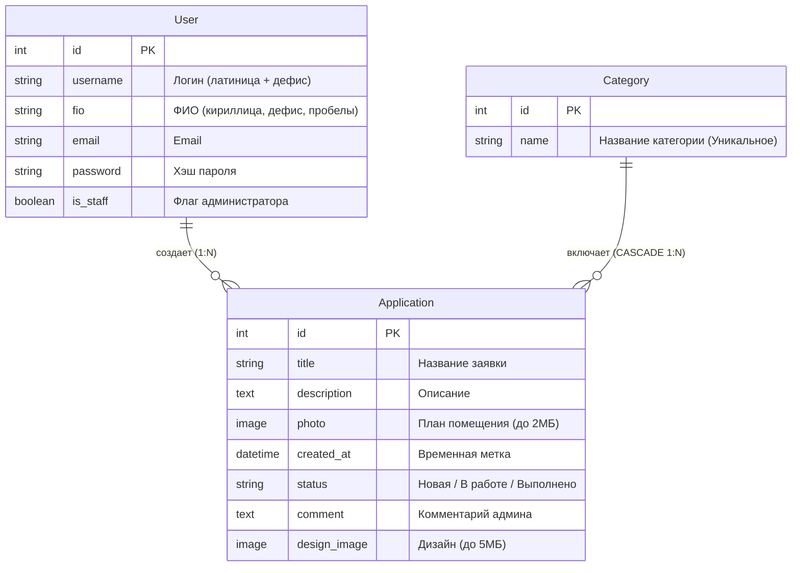

# Руководство по разработке веб-портала «Design.pro» на Django (в стиле MDN Web Docs)

> Данное руководство составлено по аналогии с официальным учебным курсом **MDN (Mozilla Developer Network) Django Tutorial** («Местная библиотека / LocalLibrary»). Оно содержит исчерпывающее пошаговое описание создания веб-приложения дизайн-студии интерьеров «Design.pro» с нуля, детальный разбор архитектуры и готовые ответы для защиты перед преподавателем.

---

## Быстрые ссылки на файлы проекта:
- ⚙️ Настройки: [design_studio/settings.py](file:///C:/Users/fer/PycharmProjects/YP_Django_3/design_studio/design_studio/settings.py)
- 🗄 Модели БД: [catalog/models.py](file:///C:/Users/fer/PycharmProjects/YP_Django_3/design_studio/catalog/models.py)
- 📝 Формы и валидация: [catalog/forms.py](file:///C:/Users/fer/PycharmProjects/YP_Django_3/design_studio/catalog/forms.py)
- ⚙️ Представления: [catalog/views.py](file:///C:/Users/fer/PycharmProjects/YP_Django_3/design_studio/catalog/views.py)
- 🧭 URL приложения: [catalog/urls.py](file:///C:/Users/fer/PycharmProjects/YP_Django_3/design_studio/catalog/urls.py)
- 🌐 Главный URL: [design_studio/urls.py](file:///C:/Users/fer/PycharmProjects/YP_Django_3/design_studio/design_studio/urls.py)
- 🛡 Админка: [catalog/admin.py](file:///C:/Users/fer/PycharmProjects/YP_Django_3/design_studio/catalog/admin.py)
- 🧪 Тесты: [catalog/tests.py](file:///C:/Users/fer/PycharmProjects/YP_Django_3/design_studio/catalog/tests.py)

---

## Оглавление

1. [Введение и постановка задачи](#1-введение-и-постановка-задачи)
2. [Подготовка окружения и инициализация проекта](#2-подготовка-окружения-и-инициализация-проекта)
3. [Конфигурация проекта (`settings.py`)](#3-конфигурация-проекта-settingspy)
4. [Проектирование моделей данных (`models.py`)](#4-проектирование-моделей-данных-modelspy)
5. [Административная панель Django (`/superadmin`)](#5-административная-панель-django-superadmin)
6. [Формы и серверная валидация (`forms.py`)](#6-формы-и-серверная-валидация-formspy)
7. [Представления и бизнес-логика (`views.py`)](#7-представления-и-бизнес-логика-viewspy)
8. [Маршрутизация URL (`urls.py`)](#8-маршрутизация-url-urlspy)
9. [Шаблоны и пользовательский интерфейс (`templates`)](#9-шаблоны-и-пользовательский-интерфейс-templates)
10. [Статика и работа с медиафайлами](#10-статика-и-работа-с-медиафайлами)
11. [Тестирование и проверка работоспособности](#11-тестирование-и-проверка-работоспособности)
12. [Вопросы и эталонные ответы для защиты перед преподавателем](#12-вопросы-и-эталонные-ответы-для-защиты-перед-преподавателем)

---

## 1. Введение и постановка задачи

### Контекст предметной области
К дизайн-студии **«Design.pro»** обращаются клиенты, желающие заказать дизайн и оформление жилых помещений.  
Система автоматизирует прием заявок, их классификацию по категориям, обработку сотрудниками дизайн-студии и демонстрацию завершенных дизайн-проектов.

### Ролевая модель
Веб-ресурс разделяет пользователей на три категории:
1. **Гость:**
   - Просмотр главной страницы (счетчик заявок в работе, последние 4 выполненные работы).
   - Вход в личный кабинет.
   - Регистрация в системе с проверкой персональных данных.
2. **Авторизованный пользователь (Клиент):**
   - Выход из системы.
   - Создание заявки на разработку интерьера с загрузкой плана помещения (до 2 Мб).
   - Просмотр собственных заявок в Личном кабинете (сортировка по новизне, фильтрация по статусам).
   - Удаление заявки (только если она имеет статус «Новая» и с подтверждением действия).
3. **Администратор (Сотрудник студии):**
   - Доступ к стандартной админ-панели по адресу `http://localhost:8089/superadmin`.
   - Доступ к пользовательской панели управления (`/admin-panel/`).
   - Смена статуса заявок:
     - «Новая» → «Принято в работу» (обязательное указание текстового комментария).
     - «Новая» → «Выполнено» (обязательное прикрепление изображения готового дизайна).
     - Блокировка повторной смены статуса, если заявка уже в работе или выполнена.
   - Управление категориями (создание и удаление категорий с автоматическим каскадным удалением привязанных заявок).

---

## 2. Подготовка окружения и инициализация проекта

Структура каталогов проектов на рабочей машине:
- Первая папка: `C:\Users\fer\PycharmProjects\YP-Django` (LocalLibrary из гайда MDN)
- Вторая папка: `C:\Users\fer\PycharmProjects\YP_Django_2`
- **Третья папка (созданная под данное ТЗ):** `C:\Users\fer\PycharmProjects\YP_Django_3`

### Шаг 2.1. Создание виртуального окружения
Откройте терминал PowerShell или командную строку:
```powershell
# Создание папки третьего проекта
mkdir C:\Users\fer\PycharmProjects\YP_Django_3
cd C:\Users\fer\PycharmProjects\YP_Django_3

# Создание изолированного виртуального окружения Python 3.12
python -m venv .venv

# Активация окружения в PowerShell
.\.venv\Scripts\Activate.ps1
```

### Шаг 2.2. Установка необходимых зависимостей
Для работы веб-портала и обработки загружаемых графических файлов (планы помещений, изображения дизайна) необходимы библиотеки `django` и `pillow`:
```powershell
python -m pip install --upgrade pip
pip install django pillow
```

### Шаг 2.3. Создание проекта Django и приложения
```powershell
# Создаем проект design_studio в текущей папке
django-admin startproject design_studio C:\Users\fer\PycharmProjects\YP_Django_3\design_studio

# Переходим в проект и создаем приложение catalog
cd design_studio
python manage.py startapp catalog
```

---

## 3. Конфигурация проекта (`settings.py`)

Откройте файл [design_studio/settings.py](file:///C:/Users/fer/PycharmProjects/YP_Django_3/design_studio/design_studio/settings.py). Внесем ключевые настройки, необходимые для решения поставленных задач.

### 3.1. Регистрация приложения и кастомной модели пользователя
По ТЗ требуется валидация поля ФИО при регистрации. Самый чистый и поддерживаемый путь в Django — расширить стандартную модель через `AbstractUser`:

```python
INSTALLED_APPS = [
    'django.contrib.admin',
    'django.contrib.auth',
    'django.contrib.contenttypes',
    'django.contrib.sessions',
    'django.contrib.messages',
    'django.contrib.staticfiles',
    # Наше приложение
    'catalog.apps.CatalogConfig',
]

# Указываем Django использовать нашу расширенную модель пользователя
AUTH_USER_MODEL = 'catalog.User'
```

### 3.2. Настройка шаблонов и статики
```python
TEMPLATES = [
    {
        'BACKEND': 'django.template.backends.django.DjangoTemplates',
        # Указываем глобальную папку шаблонов
        'DIRS': [BASE_DIR / 'templates'],
        'APP_DIRS': True,
        'OPTIONS': {
            'context_processors': [
                'django.template.context_processors.debug',
                'django.template.context_processors.request',
                'django.contrib.auth.context_processors.auth',
                'django.contrib.messages.context_processors.messages',
                'django.template.context_processors.media',
            ],
        },
    },
]
```

### 3.3. Настройка медиафайлов (загружаемые фото)
```python
STATIC_URL = '/static/'
STATICFILES_DIRS = [BASE_DIR / 'static']

MEDIA_URL = '/media/'
MEDIA_ROOT = BASE_DIR / 'media'

LOGIN_URL = 'login'
LOGIN_REDIRECT_URL = 'cabinet'
LOGOUT_REDIRECT_URL = 'index'

LANGUAGE_CODE = 'ru-ru'
TIME_ZONE = 'Europe/Moscow'
USE_I18N = True
USE_TZ = True
```

---

## 4. Проектирование моделей данных (`models.py`)

Файл: [catalog/models.py](file:///C:/Users/fer/PycharmProjects/YP_Django_3/design_studio/catalog/models.py).



### Реализация в коде:
```python
import os
from django.db import models
from django.contrib.auth.models import AbstractUser
from django.core.exceptions import ValidationError
from django.conf import settings


def validate_photo_file(file):
    """Валидация формата (jpg, jpeg, png, bmp) и размера (до 2 Мб)"""
    max_size_mb = 2
    if file.size > max_size_mb * 1024 * 1024:
        raise ValidationError(f'Максимальный размер файла не должен превышать {max_size_mb} Мб.')

    ext = os.path.splitext(file.name)[1].lower()
    valid_extensions = ['.jpg', '.jpeg', '.png', '.bmp']
    if ext not in valid_extensions:
        raise ValidationError(
            f'Недопустимый формат файла ({ext}). Разрешены только: jpg, jpeg, png, bmp.'
        )


def validate_design_file(file):
    """Валидация файла созданного дизайна"""
    max_size_mb = 5
    if file.size > max_size_mb * 1024 * 1024:
        raise ValidationError(f'Максимальный размер файла не должен превышать {max_size_mb} Мб.')

    ext = os.path.splitext(file.name)[1].lower()
    valid_extensions = ['.jpg', '.jpeg', '.png', '.bmp']
    if ext not in valid_extensions:
        raise ValidationError(
            f'Недопустимый формат файла ({ext}). Разрешены только: jpg, jpeg, png, bmp.'
        )


class User(AbstractUser):
    fio = models.CharField(
        max_length=150,
        verbose_name='ФИО',
        help_text='ФИО (только кириллические буквы, дефис и пробелы)'
    )

    class Meta:
        verbose_name = 'Пользователь'
        verbose_name_plural = 'Пользователи'

    def __str__(self):
        return f'{self.username} ({self.fio if self.fio else self.get_full_name()})'


class Category(models.Model):
    name = models.CharField(
        max_length=100,
        unique=True,
        verbose_name='Название категории'
    )

    class Meta:
        verbose_name = 'Категория'
        verbose_name_plural = 'Категории'
        ordering = ['name']

    def __str__(self):
        return self.name


class Application(models.Model):
    STATUS_NEW = 'new'
    STATUS_IN_PROGRESS = 'in_progress'
    STATUS_COMPLETED = 'completed'

    STATUS_CHOICES = [
        (STATUS_NEW, 'Новая'),
        (STATUS_IN_PROGRESS, 'Принято в работу'),
        (STATUS_COMPLETED, 'Выполнено'),
    ]

    user = models.ForeignKey(
        settings.AUTH_USER_MODEL,
        on_delete=models.CASCADE,
        related_name='applications',
        verbose_name='Пользователь'
    )
    title = models.CharField(max_length=200, verbose_name='Название заявки')
    description = models.TextField(verbose_name='Описание заявки')
    category = models.ForeignKey(
        Category,
        on_delete=models.CASCADE,  # Каскадное удаление по ТЗ
        related_name='applications',
        verbose_name='Категория заявки'
    )
    photo = models.ImageField(
        upload_to='photos/',
        validators=[validate_photo_file],
        verbose_name='Фото помещения или его план'
    )
    created_at = models.DateTimeField(
        auto_now_add=True,
        verbose_name='Временная метка добавления'
    )
    status = models.CharField(
        max_length=20,
        choices=STATUS_CHOICES,
        default=STATUS_NEW,
        verbose_name='Статус заявки'
    )
    comment = models.TextField(
        blank=True,
        null=True,
        verbose_name='Комментарий администратора'
    )
    design_image = models.ImageField(
        upload_to='designs/',
        blank=True,
        null=True,
        validators=[validate_design_file],
        verbose_name='Изображение созданного дизайна'
    )

    class Meta:
        verbose_name = 'Заявка'
        verbose_name_plural = 'Заявки'
        ordering = ['-created_at']

    def __str__(self):
        return f'#{self.pk} {self.title} [{self.get_status_display()}]'

    @property
    def is_deletable(self):
        return self.status == self.STATUS_NEW

    @property
    def can_change_status(self):
        return self.status == self.STATUS_NEW
```

> **Важно:**  
> Обратите внимание на параметр `on_delete=models.CASCADE` в поле `category`.  
> Согласно требованию ТЗ: *«При удалении категории должны быть удалены все заявки данной категории. Заявки этой категории не отображаются»*. Настройка `CASCADE` гарантирует автоматическое удаление всех дочерних заявок на уровне реляционной БД.

---

## 5. Административная панель Django (`/superadmin`)

Требование ТЗ:  
> *«Административная панель должна быть доступна по адресу: http://localhost:8089/superadmin»*

Для выполнения этого требования в [design_studio/urls.py](file:///C:/Users/fer/PycharmProjects/YP_Django_3/design_studio/design_studio/urls.py) путь административной панели настроен следующим образом:
```python
from django.contrib import admin
from django.urls import path, include

urlpatterns = [
    path('superadmin/', admin.site.urls),  # Админка доступна по /superadmin/
    path('', include('catalog.urls')),
]
```

А в файле [catalog/admin.py](file:///C:/Users/fer/PycharmProjects/YP_Django_3/design_studio/catalog/admin.py) зарегистрированы все сущности с удобным поиском и фильтрами:
```python
from django.contrib import admin
from django.contrib.auth.admin import UserAdmin
from .models import User, Category, Application

@admin.register(User)
class CustomUserAdmin(UserAdmin):
    list_display = ('username', 'fio', 'email', 'is_staff', 'is_superuser')
    search_fields = ('username', 'fio', 'email')

@admin.register(Category)
class CategoryAdmin(admin.ModelAdmin):
    list_display = ('id', 'name')
    search_fields = ('name',)

@admin.register(Application)
class ApplicationAdmin(admin.ModelAdmin):
    list_display = ('id', 'title', 'user', 'category', 'status', 'created_at')
    list_filter = ('status', 'category', 'created_at')
    search_fields = ('title', 'description', 'user__username', 'user__fio')
    readonly_fields = ('created_at',)
```

---

## 6. Формы и серверная валидация (`forms.py`)

Файл: [catalog/forms.py](file:///C:/Users/fer/PycharmProjects/YP_Django_3/design_studio/catalog/forms.py).

### 6.1. Требования к регистрации
- Вся валидация выполняется строго на стороне сервера.
- Все поля обязательны.
- ФИО: только кириллические буквы, дефис и пробелы (`^[а-яА-ЯёЁ\s-]+$`).
- Логин: только латинские буквы и дефис (`^[a-zA-Z-]+$`), уникальный в системе.
- Email: валидный формат.
- Пароль и повтор пароля: обязательное совпадение.
- Согласие на обработку персональных данных: чекбокс обязателен.

```python
import re
from django import forms
from django.core.exceptions import ValidationError
from .models import User, Application, Category, validate_photo_file

class UserRegistrationForm(forms.ModelForm):
    fio = forms.CharField(label='ФИО', max_length=150, required=True)
    username = forms.CharField(label='Логин', max_length=150, required=True)
    email = forms.EmailField(label='Email', required=True)
    password = forms.CharField(label='Пароль', required=True, widget=forms.PasswordInput)
    password_confirm = forms.CharField(label='Повтор пароля', required=True, widget=forms.PasswordInput)
    agree_data_processing = forms.BooleanField(
        label='Согласие на обработку персональных данных',
        required=True,
        error_messages={'required': 'Необходимо согласиться на обработку персональных данных.'}
    )

    class Meta:
        model = User
        fields = ['fio', 'username', 'email', 'password']

    def clean_fio(self):
        fio = self.cleaned_data.get('fio', '').strip()
        if not re.fullmatch(r'^[а-яА-ЯёЁ\s-]+$', fio):
            raise ValidationError('ФИО может содержать только кириллические буквы, дефис и пробелы.')
        return fio

    def clean_username(self):
        username = self.cleaned_data.get('username', '').strip()
        if not re.fullmatch(r'^[a-zA-Z-]+$', username):
            raise ValidationError('Логин может содержать только латинские буквы и дефис.')
        if User.objects.filter(username__iexact=username).exists():
            raise ValidationError('Пользователь с таким логином уже существует.')
        return username

    def clean(self):
        cleaned_data = super().clean()
        p1 = cleaned_data.get('password')
        p2 = cleaned_data.get('password_confirm')
        if p1 and p2 and p1 != p2:
            self.add_error('password_confirm', 'Пароли не совпадают. Пожалуйста, повторите ввод.')
        return cleaned_data

    def save(self, commit=True):
        user = super().save(commit=False)
        user.set_password(self.cleaned_data['password'])
        if commit:
            user.save()
        return user
```

### 6.2. Форма создания заявки
```python
class ApplicationCreateForm(forms.ModelForm):
    class Meta:
        model = Application
        fields = ['title', 'description', 'category', 'photo']

    def clean_photo(self):
        photo = self.cleaned_data.get('photo')
        if photo:
            validate_photo_file(photo)
        else:
            raise ValidationError('Прикрепление фото помещения или плана обязательно.')
        return photo
```

---

## 7. Представления и бизнес-логика (`views.py`)

Файл: [catalog/views.py](file:///C:/Users/fer/PycharmProjects/YP_Django_3/design_studio/catalog/views.py).

### 7.1. Главная страница
```python
def index(request):
    # Счетчик заявок со статусом «Принято в работу»
    in_progress_count = Application.objects.filter(status=Application.STATUS_IN_PROGRESS).count()

    # Не более 4 последних заявок со статусом «Выполнено»
    completed_apps = Application.objects.filter(
        status=Application.STATUS_COMPLETED
    ).select_related('category').order_by('-created_at')[:4]

    return render(request, 'index.html', {
        'in_progress_count': in_progress_count,
        'completed_apps': completed_apps,
    })
```

### 7.2. Личный кабинет с фильтрацией заявок
```python
@login_required
def cabinet_view(request):
    user_apps = Application.objects.filter(user=request.user).select_related('category')

    # Подсчет для бейджей фильтрации
    total_count = user_apps.count()
    new_count = user_apps.filter(status=Application.STATUS_NEW).count()
    in_progress_count = user_apps.filter(status=Application.STATUS_IN_PROGRESS).count()
    completed_count = user_apps.filter(status=Application.STATUS_COMPLETED).count()

    # Фильтрация по GET-параметру ?status=...
    current_filter = request.GET.get('status', 'all')
    if current_filter in [Application.STATUS_NEW, Application.STATUS_IN_PROGRESS, Application.STATUS_COMPLETED]:
        user_apps = user_apps.filter(status=current_filter)

    user_apps = user_apps.order_by('-created_at')  # Недавно добавленные в начале

    return render(request, 'catalog/cabinet.html', {
        'applications': user_apps,
        'current_filter': current_filter,
        'total_count': total_count,
        'new_count': new_count,
        'in_progress_count': in_progress_count,
        'completed_count': completed_count,
    })
```

### 7.3. Удаление заявки (проверка прав и статуса)
```python
@login_required
def delete_application_view(request, pk):
    # Пользователь может удалить ТОЛЬКО свою заявку
    application = get_object_or_404(Application, pk=pk, user=request.user)

    # Удалить можно ТОЛЬКО со статусом «Новая»
    if not application.is_deletable:
        messages.error(request, 'Запрещено! Заявку нельзя удалить, так как её статус уже изменен.')
        return redirect('cabinet')

    if request.method == 'POST':
        title = application.title
        application.delete()
        messages.success(request, f'Заявка «{title}» успешно удалена.')
        return redirect('cabinet')

    return render(request, 'catalog/application_confirm_delete.html', {'application': application})
```

### 7.4. Смена статусов администратором
```python
@user_passes_test(lambda u: u.is_staff or u.is_superuser)
def admin_change_status_in_progress(request, pk):
    application = get_object_or_404(Application, pk=pk)
    if application.status != Application.STATUS_NEW:
        messages.error(request, 'Смена статуса с «Принято в работу» или «Выполнено» невозможна.')
        return redirect('admin_panel')

    if request.method == 'POST':
        comment = request.POST.get('comment', '').strip()
        if comment:
            application.status = Application.STATUS_IN_PROGRESS
            application.comment = comment
            application.save()
            messages.success(request, f'Заявка #{application.pk} переведена в статус «Принято в работу».')
        else:
            messages.error(request, 'Указание комментария обязательно!')
    return redirect('admin_panel')
```

---

## 8. Маршрутизация URL (`urls.py`)

Файл: [catalog/urls.py](file:///C:/Users/fer/PycharmProjects/YP_Django_3/design_studio/catalog/urls.py).

```python
from django.urls import path
from . import views

urlpatterns = [
    # Главная страница
    path('', views.index, name='index'),

    # Авторизация и регистрация
    path('register/', views.register_view, name='register'),
    path('login/', views.login_view, name='login'),
    path('logout/', views.logout_view, name='logout'),

    # Личный кабинет и работа с заявками
    path('cabinet/', views.cabinet_view, name='cabinet'),
    path('application/create/', views.create_application_view, name='application-create'),
    path('application/<int:pk>/delete/', views.delete_application_view, name='application-delete'),

    # Административная панель управления
    path('admin-panel/', views.admin_panel_view, name='admin_panel'),
    path('admin-panel/application/<int:pk>/in-progress/', views.admin_change_status_in_progress, name='admin-status-in-progress'),
    path('admin-panel/application/<int:pk>/completed/', views.admin_change_status_completed, name='admin-status-completed'),
    path('admin-panel/category/add/', views.admin_add_category, name='admin-add-category'),
    path('admin-panel/category/<int:pk>/delete/', views.admin_delete_category, name='admin-delete-category'),
]
```

---

## 9. Шаблоны и пользовательский интерфейс (`templates`)

Интерфейс построен на фреймворке **Bootstrap 5** с иконками **Bootstrap Icons**.  
Все страницы связаны элементами навигации:

1. [templates/base.html](file:///C:/Users/fer/PycharmProjects/YP_Django_3/design_studio/templates/base.html):
   - Навигационное меню (Главная, Мои заявки, Создать заявку, Панель администратора, Superadmin, Вход/Регистрация/Выход).
   - Вывод системных сообщений Django (`django.contrib.messages`).
   - Адаптивный подвал с копирайтом и ссылкой на `/superadmin`.
2. [templates/index.html](file:///C:/Users/fer/PycharmProjects/YP_Django_3/design_studio/templates/index.html):
   - Презентационный баннер студии «Design.pro».
   - Интерактивный счетчик заявок в работе: `{{ in_progress_count }}`.
   - Сетка из 4 карточек последних выполненных проектов с фотографиями и категорией.
3. [templates/registration/register.html](file:///C:/Users/fer/PycharmProjects/YP_Django_3/design_studio/templates/registration/register.html):
   - Форма с подсветкой некорректно заполненных полей (`is-invalid`) и текстом ошибок валидации.
4. [templates/registration/login.html](file:///C:/Users/fer/PycharmProjects/YP_Django_3/design_studio/templates/registration/login.html):
   - Вход по логину и паролю.
5. [templates/catalog/cabinet.html](file:///C:/Users/fer/PycharmProjects/YP_Django_3/design_studio/templates/catalog/cabinet.html):
   - Таблица/карточки заявок пользователя.
   - Кнопки быстрой фильтрации по статусам.
   - Окна для подтверждения удаления заявки со статусом «Новая».
6. [templates/catalog/admin_panel.html](file:///C:/Users/fer/PycharmProjects/YP_Django_3/design_studio/templates/catalog/admin_panel.html):
   - Разделы: Заявки и Управление категориями.
   - Модальное окно перевода в статус «Принято в работу» с обязательным полем комментария.
   - Модальное окно перевода в статус «Выполнено» с обязательной загрузкой изображения дизайна.
   - Управление категориями и модальное предупреждение о каскадном удалении.

---

## 10. Статика и работа с медиафайлами

Загрузка фотографий настроена через встроенные обработчики Django:
- В `settings.py`:
  - `MEDIA_ROOT = BASE_DIR / 'media'`
  - `MEDIA_URL = '/media/'`
- В `design_studio/urls.py`:
  ```python
  if settings.DEBUG:
      urlpatterns += static(settings.MEDIA_URL, document_root=settings.MEDIA_ROOT)
  ```
Файлы сохраняются структурированно в каталоги `media/photos/` и `media/designs/`.

---

## 11. Тестирование и проверка работоспособности

В файле [catalog/tests.py](file:///C:/Users/fer/PycharmProjects/YP_Django_3/design_studio/catalog/tests.py) реализовано 6 автоматических тестов, проверяющих каждый пункт ТЗ:
1. `test_registration_validation`: проверка отклонения латиницы в ФИО, кириллицы в логине, несовпадения паролей и отсутствия согласия на обработку ПДн.
2. `test_create_application_validation`: проверка блокировки недопустимых расширений (`.txt`) и успешного создания заявок со статусом `Новая`.
3. `test_delete_application_restrictions`: проверка запрета на удаление заявок со статусом «Принято в работу» и разрешения удаления для статуса «Новая».
4. `test_admin_status_transitions`: проверка обязательности комментария при статусе «В работе» и запрета повторного изменения статуса.
5. `test_category_cascade_delete`: проверка каскадного удаления всех заявок при удалении категории.
6. `test_main_page_counter_and_limit`: проверка счетчика заявок в работе и среза `[:4]` для выполненных работ.

### Запуск тестов:
```powershell
python manage.py test
```
Результат:
```text
Ran 6 tests in 10.995s
OK
```

### Запуск веб-сервера на порту 8089:
```powershell
python manage.py runserver 8089
```

---

## 12. Вопросы и эталонные ответы для защиты перед преподавателем

### Вопрос 1: Как реализована ролевая модель и разграничение прав доступа?
**Ответ:**  
> «В проекте используются стандартные возможности модуля `django.contrib.auth`. Пользователи делятся на три группы:
> 1. Неаутентифицированные (гости) — проверка через `request.user.is_authenticated`.
> 2. Аутентифицированные клиенты — доступ к личному кабинету и созданию заявок ограничен декоратором `@login_required`.
> 3. Администраторы — проверка через флаги `is_staff` / `is_superuser` и декоратор `@user_passes_test(is_admin)`.  
> В шаблонах видимость ссылок и кнопок управляется тегами `` и ``».

### Вопрос 2: Как устроена серверная валидация регистрации и где она проверяется?
**Ответ:**  
> «Валидация полностью реализована на бэкенде в классе `UserRegistrationForm(forms.ModelForm)` в файле `catalog/forms.py`:
> - Для ФИО переопределен метод `clean_fio()` с регулярным выражением `^[а-яА-ЯёЁ\s-]+$`.
> - Для логина переопределен метод `clean_username()` с регулярным выражением `^[a-zA-Z-]+$` и проверкой уникальности через запрос `User.objects.filter(...)`.
> - Совпадение паролей проверяется в общем методе `clean()`, а чекбокс согласия на обработку данных имеет атрибут `required=True`. При ошибках Django возвращает форму с ошибками, которые подсвечивают невалидные поля классом `is-invalid`».

### Вопрос 3: Как реализовано требование каскадного удаления заявок при удалении категории?
**Ответ:**  
> «В модели `Application` связь с категорией объявлена как `category = models.ForeignKey(Category, on_delete=models.CASCADE, related_name='applications')`. Параметр `models.CASCADE` указывает Django и СУБД SQLite, что при удалении записи родительской таблицы `Category` все связанные дочерние записи в таблице `Application` удаляются автоматически».

### Вопрос 4: Как гарантируется, что пользователь не сможет удалить чужую заявку или заявку, которая уже в работе?
**Ответ:**  
> «Проверка выполняется на двух уровнях:
> 1. В представлении `delete_application_view`: запрос объекта делается строго с фильтром по текущему пользователю: `get_object_or_404(Application, pk=pk, user=request.user)`. Чужую заявку пользователь получить не сможет (вызовется 404 Http Not Found).
> 2. Проверяется свойство объекта `application.is_deletable` (статус равен `STATUS_NEW`). Если статус уже 'in_progress' или 'completed', операция прерывается и пользователю выводится ошибка».

### Вопрос 5: Как работает счетчик заявок в работе и вывод 4 последних выполненных работ на главной странице?
**Ответ:**  
> «В функции представления `index()` выполняются оптимизированные ORM-запросы:
> - Для счетчика используется метод `.count()`: `Application.objects.filter(status='in_progress').count()`.
> - Для карточек выполненных работ выполняется фильтрация по статусу, сортировка по убыванию даты (`-created_at`) и срез `[:4]`, что транслируется в SQL-запрос `LIMIT 4`».

### Вопрос 6: Почему стандартная админка Django перенесена на адрес `/superadmin`?
**Ответ:**  
> «Согласно инструкции для студента в ТЗ: *'Административная панель должна быть доступна по адресу: http://localhost:8089/superadmin'*. В файле `design_studio/urls.py` мы связали путь `path('superadmin/', admin.site.urls)`, переопределив стандартный путь `admin/`».
