# Полное теоретическое и практическое руководство по проекту «Design.pro» на Django (TUTORIAL 2)

> Данный документ объединяет в себе подробнейший пошаговый курс разработки (в стиле официального руководства **MDN Web Docs — Местная библиотека / LocalLibrary**), глубокое теоретическое погружение в архитектуру Django и обоснование всех инженерных решений, принятых в проекте.  
> Руководство рассчитано на изучение в процессе работы и полноценную подготовку к защите перед преподавателем или экзаменационной комиссией.

---

## 🧭 Навигация по файлам проекта:

### Бэкенд и логика:
- ⚙️ **Конфигурация ядра:** [design_studio/settings.py](file:///C:/Users/fer/PycharmProjects/YP_Django_3/design_studio/design_studio/settings.py)
- 🗄 **Модели базы данных (User, Category, Application):** [catalog/models.py](file:///C:/Users/fer/PycharmProjects/YP_Django_3/design_studio/catalog/models.py)
- 📝 **Формы и строгая серверная валидация:** [catalog/forms.py](file:///C:/Users/fer/PycharmProjects/YP_Django_3/design_studio/catalog/forms.py)
- 🧠 **Контроллеры и бизнес-логика (Views):** [catalog/views.py](file:///C:/Users/fer/PycharmProjects/YP_Django_3/design_studio/catalog/views.py)
- 🧭 **Маршрутизация приложения:** [catalog/urls.py](file:///C:/Users/fer/PycharmProjects/YP_Django_3/design_studio/catalog/urls.py)
- 🌐 **Маршрутизация проекта (включая `/superadmin`):** [design_studio/urls.py](file:///C:/Users/fer/PycharmProjects/YP_Django_3/design_studio/design_studio/urls.py)
- 🛡 **Регистрация в панели Django:** [catalog/admin.py](file:///C:/Users/fer/PycharmProjects/YP_Django_3/design_studio/catalog/admin.py)
- 🧪 **Пакет автоматизированных тестов (6 тестов):** [catalog/tests.py](file:///C:/Users/fer/PycharmProjects/YP_Django_3/design_studio/catalog/tests.py)

### Пользовательский интерфейс (Templates):
- 🧱 **Базовый каркас сайта (Header, Navbar, Footer):** [templates/base.html](file:///C:/Users/fer/PycharmProjects/YP_Django_3/design_studio/templates/base.html)
- 🏠 **Главная страница (счетчик и 4 карточки):** [templates/index.html](file:///C:/Users/fer/PycharmProjects/YP_Django_3/design_studio/templates/index.html)
- 👤 **Личный кабинет (фильтры, таблица, удаление):** [templates/catalog/cabinet.html](file:///C:/Users/fer/PycharmProjects/YP_Django_3/design_studio/templates/catalog/cabinet.html)
- ✍️ **Создание заявки (загрузка плана до 2 Мб):** [templates/catalog/application_form.html](file:///C:/Users/fer/PycharmProjects/YP_Django_3/design_studio/templates/catalog/application_form.html)
- 🗑 **Подтверждение удаления заявки:** [templates/catalog/application_confirm_delete.html](file:///C:/Users/fer/PycharmProjects/YP_Django_3/design_studio/templates/catalog/application_confirm_delete.html)
- 🛠 **Панель управления администратора (заявки + категории):** [templates/catalog/admin_panel.html](file:///C:/Users/fer/PycharmProjects/YP_Django_3/design_studio/templates/catalog/admin_panel.html)
- 🚪 **Авторизация пользователей:** [templates/registration/login.html](file:///C:/Users/fer/PycharmProjects/YP_Django_3/design_studio/templates/registration/login.html)
- 📋 **Регистрация (с серверной подсветкой ошибок):** [templates/registration/register.html](file:///C:/Users/fer/PycharmProjects/YP_Django_3/design_studio/templates/registration/register.html)
- 🎨 **Минималистичные CSS-стили:** [static/css/style.css](file:///C:/Users/fer/PycharmProjects/YP_Django_3/design_studio/static/css/style.css)

---

## Оглавление

1. [Теоретический фундамент: Архитектура Django и паттерн MVT](#1-теоретический-фундамент-архитектура-django-и-паттерн-mvt)
2. [Анализ Технического Задания и системное проектирование](#2-анализ-технического-задания-и-системное-проектирование)
3. [Шаг 1. Подготовка окружения и запуск проекта с нуля](#шаг-1-подготовка-окружения-и-запуск-проекта-с-нуля)
4. [Шаг 2. Конфигурация ядра (`settings.py`) — детальный разбор](#шаг-2-конфигурация-ядра-settingspy--детальный-разбор)
5. [Шаг 3. Архитектура хранилища `media` (почему photos/ и designs/)](#шаг-3-архитектура-хранилища-media-почему-photos-и-designs)
6. [Шаг 4. Модели данных (`models.py`) и реляционная база](#шаг-4-модели-данных-modelspy-и-реляционная-база)
7. [Шаг 5. Миграции и создание учетных записей](#шаг-5-миграции-и-создание-учетных-записей)
8. [Шаг 6. Административная панель Django и перенос на `/superadmin`](#шаг-6-административная-панель-django-и-перенос-на-superadmin)
9. [Шаг 7. Формы и строгая серверная валидация (`forms.py`)](#шаг-7-формы-и-строгая-серверная-валидация-formspy)
10. [Шаг 8. Представления (Views) и бизнес-логика (`views.py`)](#шаг-8-представления-views-и-бизнес-логика-viewspy)
11. [Шаг 9. Маршрутизация URL (`urls.py`)](#шаг-9-маршрутизация-url-urlspy)
12. [Шаг 10. Детальная сборка шаблонов (Templates) и язык DTL](#шаг-10-детальная-сборка-шаблонов-templates-и-язык-dtl)
13. [Шаг 11. Автоматизированное тестирование (`tests.py`)](#шаг-11-автоматизированное-тестирование-testspy)
14. [Шаг 12. ТОП-25 вопросов и эталонных ответов для защиты](#шаг-12-топ-25-вопросов-и-эталонных-ответов-для-защиты)

---

## 1. Теоретический фундамент: Архитектура Django и паттерн MVT

Веб-фреймворк Django реализует архитектурный паттерн **MVT (Model-View-Template)**, являющийся модификацией классического **MVC (Model-View-Controller)**:

```
 Пользователь (Браузер)
      │ ▲
      │ │ 6. Итоговый HTTP-ответ (HTML + CSS)
      ▼ │
┌────────────────────────────────────────────────────────┐
│                        DJANGO                          │
│                                                        │
│  1. WSGI / ASGI Handler                                │
│     Точка входа, преобразует сетевой поток в объект    │
│     запроса HttpRequest                                │
│            │                                           │
│            ▼                                           │
│  2. MIDDLEWARE (Слой промежуточной обработки)          │
│     Сессии, безопасность, аутентификация, CSRF-защита  │
│            │                                           │
│            ▼                                           │
│  3. URLconf (urls.py)                                  │
│     Диспетчер маршрутов: сопоставляет URL с View       │
│            │                                           │
│            ▼                                           │
│  4. View (views.py) ── [Контроллер бизнес-логики]      │
│            │                             ▲             │
│            │ Запрос данных               │ Данные      │
│            ▼                             │             │
│     Model (models.py) ◄──────────────────┘             │
│     Django ORM (Object-Relational Mapping) ── SQLite   │
│            │                                           │
│            │ Передача контекста                        │
│            ▼                                           │
│  5. Template Engine (templates/*.html)                 │
│     Рендеринг HTML с подстановкой переменных (DTL)     │
└────────────────────────────────────────────────────────┘
```

### Сравнение терминологии Django и MVC:
| Компонент в Django | Аналог в классическом MVC | Роль и назначение в проекте |
| :--- | :--- | :--- |
| **Model** (`models.py`) | **Model** | Схема данных, таблицы БД, валидаторы на уровне сущностей, ORM-запросы. |
| **View** (`views.py`) | **Controller** | Принимает запрос, проверяет права доступа, обрабатывает формы, обращается к моделям, решает, какой ответ вернуть. |
| **Template** (`templates/`) | **View** | Пользовательский интерфейс: чистый HTML с вкраплениями языка тегов DTL. |

### Полный жизненный цикл HTTP-запроса:
1. Пользователь в браузере вводит `http://localhost:8089/cabinet/` и нажимает Enter.
2. Веб-сервер получает TCP-пакет и передает его в WSGI-обработчик Django (`wsgi.py`).
3. Запрос проходит сквозь цепочку **Middleware** (промежуточных слоев):
   - `SessionMiddleware`: считывает cookie сессии и прикрепляет к запросу хранилище данных `request.session`.
   - `AuthenticationMiddleware`: по ID из сессии находит пользователя в базе данных и сохраняет его в `request.user`.
   - `CsrfViewMiddleware`: проверяет наличие и валидность токена безопасности при POST-запросах.
4. **URLconf** (`design_studio/urls.py` ➔ `catalog/urls.py`) по регулярному выражению находит совпадение с маршрутом `cabinet/` и вызывает функцию `cabinet_view(request)`.
5. Декоратор `@login_required` проверяет `request.user.is_authenticated`. Если пользователь гость — возвращает редирект на `/login/`.
6. Функция `cabinet_view` запрашивает данные через Django ORM:
   ```python
   user_apps = Application.objects.filter(user=request.user).order_by('-created_at')
   ```
7. ORM транслирует Python-код в SQL-запрос `SELECT * FROM catalog_application WHERE user_id = ... ORDER BY created_at DESC;`.
8. Функция вызывает `render(request, 'catalog/cabinet.html', context)`.
9. Движок DTL объединяет HTML-шаблон с контекстом (списком заявок) и собирает финальный HTML-документ.
10. WSGI-сервер возвращает браузеру ответ со статусом `200 OK` и заголовком `Content-Type: text/html`.

---

## 2. Анализ Технического Задания и системное проектирование

### Предметная область:
Дизайн-студия **«Design.pro»** занимается проектированием и оформлением интерьеров жилых помещений. Заказчики загружают планы и фото помещений, а сотрудники дизайн-студии берут их в работу и прикрепляют готовые дизайн-проекты.

### Ролевая модель:
```
           ┌──────────────┐
           │     ГОСТЬ    │
           └──────┬───────┘
                  │
        ┌─────────┴─────────┐
        ▼                   ▼
┌──────────────┐    ┌──────────────┐
│ Вход на сайт │    │ Регистрация  │
└──────┬───────┘    └──────┬───────┘
       │                   │
       └─────────┬─────────┘
                 ▼
    ┌──────────────────────────┐
    │ АВТОРИЗОВАННЫЙ КЛИЕНТ    │
    ├──────────────────────────┤
    │ • Просмотр своих заявок  │
    │ • Фильтрация по статусам │
    │ • Создание новой заявки  │
    │ • Удаление заявки (Новая)│
    │ • Выход из аккаунта      │
    └────────────┬─────────────┘
                 │
                 ▼ (при наличии флага is_staff / is_superuser)
    ┌──────────────────────────┐
    │      АДМИНИСТРАТОР       │
    ├──────────────────────────┤
    │ • Панель /admin-panel/   │
    │ • Админка /superadmin    │
    │ • Смена статуса заявки   │
    │ • Управление категориями │
    └──────────────────────────┘
```

### Конечный автомат (State Machine) заявки:
Каждая заявка может находиться строго в одном из 3 статусов:
```
                   ┌─────────────────┐
                   │  [1] «Новая»    │ (создается клиентом автоматически)
                   └────────┬────────┘
                            │
            ┌───────────────┴───────────────┐
            │                               │
(действие админа с комментарием)    (действие админа с файлом дизайна)
            │                               │
            ▼                               ▼
┌───────────────────────┐       ┌───────────────────────┐
│ [2] «Принято в работу»│       │   [3] «Выполнено»     │
└───────────────────────┘       └───────────────────────┘
            │                               │
            └───────────────┬───────────────┘
                            ▼
              [СМЕНА СТАТУСА ЗАБЛОКИРОВАНА]
            (удаление клиенту также запрещено)
```

---

## 3. Шаг 1. Подготовка окружения и запуск проекта с нуля

Проект расположен в третьей папке: `C:\Users\fer\PycharmProjects\YP_Django_3`.

```powershell
# 1. Создание папки и переход в нее
mkdir C:\Users\fer\PycharmProjects\YP_Django_3
cd C:\Users\fer\PycharmProjects\YP_Django_3

# 2. Создание виртуального окружения Python 3.12
python -m venv .venv

# 3. Активация окружения в PowerShell
.\.venv\Scripts\Activate.ps1

# 4. Установка Django и Pillow (для работы с картинками)
python -m pip install --upgrade pip
pip install django pillow

# 5. Инициализация проекта и приложения
django-admin startproject design_studio C:\Users\fer\PycharmProjects\YP_Django_3\design_studio
cd design_studio
python manage.py startapp catalog
```

---

## 4. Шаг 2. Конфигурация ядра (`settings.py`) — детальный разбор

Файл: [design_studio/settings.py](file:///C:/Users/fer/PycharmProjects/YP_Django_3/design_studio/design_studio/settings.py).

### Разбор настроек:

```python
from pathlib import Path

# BASE_DIR — абсолютный путь к папке проекта (C:\Users\fer\PycharmProjects\YP_Django_3\design_studio)
BASE_DIR = Path(__file__).resolve().parent.parent

# SECRET_KEY — криптографическая соль для подписания cookies, сессий и CSRF-токенов
SECRET_KEY = 'django-insecure-design-pro-study-key-2026'

# DEBUG = True включает подробную отладочную страницу при ошибках (только для разработки!)
DEBUG = True

# ALLOWED_HOSTS = ['*'] разрешает подключаться по localhost, 127.0.0.1 и любому IP
ALLOWED_HOSTS = ['*']

# Регистрация стандартных подсистем и нашего приложения
INSTALLED_APPS = [
    'django.contrib.admin',
    'django.contrib.auth',
    'django.contrib.contenttypes',
    'django.contrib.sessions',
    'django.contrib.messages',
    'django.contrib.staticfiles',
    'catalog.apps.CatalogConfig',  # Подключаем наше приложение студии
]

# Указываем Django использовать нашу расширенную модель пользователя вместо стандартной
AUTH_USER_MODEL = 'catalog.User'

# Промежуточное ПО (Middleware)
MIDDLEWARE = [
    'django.middleware.security.SecurityMiddleware',
    'django.contrib.sessions.middleware.SessionMiddleware', # Управление сессиями
    'django.middleware.common.CommonMiddleware',
    'django.middleware.csrf.CsrfViewMiddleware',             # Защита от CSRF
    'django.contrib.auth.middleware.AuthenticationMiddleware', # Прикрепление user к request
    'django.contrib.messages.middleware.MessageMiddleware', # Всплывающие уведомления
    'django.middleware.clickjacking.XFrameOptionsMiddleware',
]

ROOT_URLCONF = 'design_studio.urls'

# Конфигурация шаблонизатора DTL
TEMPLATES = [
    {
        'BACKEND': 'django.template.backends.django.DjangoTemplates',
        # Указываем глобальную папку templates в корне проекта
        'DIRS': [BASE_DIR / 'templates'],
        'APP_DIRS': True, # Искать шаблоны и внутри каталогов приложений
        'OPTIONS': {
            'context_processors': [
                'django.template.context_processors.debug',
                'django.template.context_processors.request', # Переменная {{ request }}
                'django.contrib.auth.context_processors.auth', # Переменная {{ user }}
                'django.contrib.messages.context_processors.messages', # Переменная {{ messages }}
                'django.template.context_processors.media',   # Переменная {{ MEDIA_URL }}
            ],
        },
    },
]

# База данных: используем встраиваемую реляционную СУБД SQLite
DATABASES = {
    'default': {
        'ENGINE': 'django.db.backends.sqlite3',
        'NAME': BASE_DIR / 'db.sqlite3',
    }
}

# Язык интерфейса и часовой пояс
LANGUAGE_CODE = 'ru-ru'
TIME_ZONE = 'Europe/Moscow'
USE_I18N = True
USE_TZ = True

# Статика разработчика (CSS, JS)
STATIC_URL = '/static/'
STATICFILES_DIRS = [BASE_DIR / 'static']

# Медиафайлы пользователей (загружаемые фото планов и готовых дизайнов)
MEDIA_URL = '/media/'
MEDIA_ROOT = BASE_DIR / 'media'

# Маршруты для перенаправлений аутентификации
LOGIN_URL = 'login'              # Куда перенаправлять неавторизованного
LOGIN_REDIRECT_URL = 'cabinet'   # Куда направить после успешного входа
LOGOUT_REDIRECT_URL = 'index'    # Куда направить после выхода
```

---

## 5. Шаг 3. Архитектура хранилища `media`: почему `photos/` и `designs/`

```
media/
├── photos/    <-- Планы помещений и фото комнат от клиентов (до 2 Мб)
└── designs/   <-- Готовые дизайн-проекты и визуализации от администратора
```

### Глубокое обоснование для руководителя/преподавателя:
1. **Принцип единственной ответственности (Separation of Concerns):**  
   Файлы заказчиков (технические планы, чертежи БТИ, фото без отделки) и файлы студии (3D-визуализации, эскизы) — это концептуально разные данные. Смешивать их в одной общей папке — грубая архитектурная ошибка.
2. **Почему не использована разбивка по датам (`upload_to='photos/%Y/%m/'`):**  
   В операционных системах Linux на каждую папку выделяется структура индексных дескрипторов (`inodes`). Когда в одной папке накапливается свыше 50 000 файлов, поиск файла файловой системой замедляется. Поэтому высоконагруженные порталы (Авито, Ozon) дробят файлы по годам и месяцам.  
   В студенческом проекте или демонстрационном экзамене важнее всего **наглядность и простота проверки**. Структура `photos/` и `designs/` исключает блуждание по пустым папкам с годами и днями: преподаватель сразу видит входящие файлы в `photos/` и результаты в `designs/`.

---

## 6. Шаг 4. Модели данных (`models.py`) и реляционная база

Файл: [catalog/models.py](file:///C:/Users/fer/PycharmProjects/YP_Django_3/design_studio/catalog/models.py).

```mermaid
erDiagram
    User ||--o{ Application : "создает (1:N)"
    Category ||--o{ Application : "включает (CASCADE 1:N)"

    User {
        int id PK
        string username "Логин (только латиница и дефис)"
        string fio "ФИО (только кириллица, дефис, пробелы)"
        string email "Email"
        string password "PBKDF2-хеш"
        boolean is_staff "Флаг администратора"
    }

    Category {
        int id PK
        string name "Название категории (Уникальное)"
    }

    Application {
        int id PK
        string title "Название заявки"
        text description "Описание"
        image photo "План помещения (до 2Мб)"
        datetime created_at "Временная метка"
        string status "Новая / Принято в работу / Выполнено"
        text comment "Комментарий администратора"
        image design_image "Изображение дизайн"
    }
```



### Исходный код с подробными комментариями:

```python
import os
from django.db import models
from django.contrib.auth.models import AbstractUser
from django.core.exceptions import ValidationError
from django.conf import settings


# 1. Валидатор фото помещения: форматы (jpg, jpeg, png, bmp) и вес до 2 МБ
def validate_photo_file(file):
    max_size_mb = 2
    # Размер файла в байтах: 2 * 1024 * 1024 = 2 097 152 байт
    if file.size > max_size_mb * 1024 * 1024:
        raise ValidationError(f'Максимальный размер файла не должен превышать {max_size_mb} Мб.')
    
    ext = os.path.splitext(file.name)[1].lower()
    valid_extensions = ['.jpg', '.jpeg', '.png', '.bmp']
    if ext not in valid_extensions:
        raise ValidationError(f'Недопустимый формат файла ({ext}). Разрешены только: jpg, jpeg, png, bmp.')


# 2. Валидатор файла готового дизайна от администратора
def validate_design_file(file):
    max_size_mb = 5
    if file.size > max_size_mb * 1024 * 1024:
        raise ValidationError(f'Максимальный размер файла не должен превышать {max_size_mb} Мб.')
    
    ext = os.path.splitext(file.name)[1].lower()
    valid_extensions = ['.jpg', '.jpeg', '.png', '.bmp']
    if ext not in valid_extensions:
        raise ValidationError(f'Недопустимый формат файла ({ext}). Разрешены только: jpg, jpeg, png, bmp.')


# 3. Кастомная модель пользователя с полем ФИО
class User(AbstractUser):
    fio = models.CharField(
        max_length=150,
        verbose_name='ФИО',
        help_text='ФИО (только кириллические буквы, дефис и пробелы)'
    )

    class Meta:
        verbose_name = 'Пользователь'
        verbose_name_plural = 'Пользователи'

    def __str__(self):
        return f'{self.username} ({self.fio if self.fio else self.get_full_name()})'


# 4. Категория заявки
class Category(models.Model):
    name = models.CharField(
        max_length=100,
        unique=True, # Название категории должно быть уникальным
        verbose_name='Название категории'
    )

    class Meta:
        verbose_name = 'Категория'
        verbose_name_plural = 'Категории'
        ordering = ['name']

    def __str__(self):
        return self.name


# 5. Заявка на разработку дизайна
class Application(models.Model):
    STATUS_NEW = 'new'
    STATUS_IN_PROGRESS = 'in_progress'
    STATUS_COMPLETED = 'completed'

    STATUS_CHOICES = [
        (STATUS_NEW, 'Новая'),
        (STATUS_IN_PROGRESS, 'Принято в работу'),
        (STATUS_COMPLETED, 'Выполнено'),
    ]

    user = models.ForeignKey(
        settings.AUTH_USER_MODEL,
        on_delete=models.CASCADE,
        related_name='applications',
        verbose_name='Пользователь'
    )
    title = models.CharField(max_length=200, verbose_name='Название заявки')
    description = models.TextField(verbose_name='Описание заявки')

    # ВАЖНО ПО ТЗ: при удалении категории каскадно удаляются все её заявки!
    category = models.ForeignKey(
        Category,
        on_delete=models.CASCADE,
        related_name='applications',
        verbose_name='Категория заявки'
    )

    # Фото плана сохраняется в media/photos/ с проверкой валидатора
    photo = models.ImageField(
        upload_to='photos/',
        validators=[validate_photo_file],
        verbose_name='Фото помещения или его план'
    )

    # Временная метка проставляется СУБД автоматически в момент добавления
    created_at = models.DateTimeField(
        auto_now_add=True,
        verbose_name='Временная метка добавления'
    )

    # Статус заявки по умолчанию — "Новая"
    status = models.CharField(
        max_length=20,
        choices=STATUS_CHOICES,
        default=STATUS_NEW,
        verbose_name='Статус заявки'
    )

    # Комментарий администратора (при смене на "Принято в работу")
    comment = models.TextField(
        blank=True,
        null=True,
        verbose_name='Комментарий администратора'
    )

    # Изображение дизайна от администратора (при смене на "Выполнено")
    design_image = models.ImageField(
        upload_to='designs/',
        blank=True,
        null=True,
        validators=[validate_design_file],
        verbose_name='Изображение созданного дизайна'
    )

    class Meta:
        verbose_name = 'Заявка'
        verbose_name_plural = 'Заявки'
        ordering = ['-created_at'] # Сортировка по умолчанию: недавно добавленные в начале

    def __str__(self):
        return f'#{self.pk} {self.title} [{self.get_status_display()}]'

    @property
    def is_deletable(self):
        """Удалять разрешено ТОЛЬКО со статусом 'Новая'"""
        return self.status == self.STATUS_NEW

    @property
    def can_change_status(self):
        """Менять статус разрешено ТОЛЬКО со статуса 'Новая'"""
        return self.status == self.STATUS_NEW
```

---

## 7. Шаг 5. Миграции и создание учетных записей

### Что делают команды миграций:
```powershell
# 1. Анализирует models.py и создает файл миграции
python manage.py makemigrations

# 2. Читает файлы миграций и выполняет SQL-запросы в db.sqlite3
python manage.py migrate
```

### Создание учетных записей по ТЗ:
В базе данных `db.sqlite3` уже созданы учетные записи:
- **Администратор:** логин `admin`, пароль `admin` (установлены флаги `is_staff = True`, `is_superuser = True`).
- **Клиент (демо):** логин `ivanov`, пароль `ivanov123`.

---

## 8. Шаг 6. Административная панель Django и перенос на `/superadmin`

Требование ТЗ:
> *«Административная панель должна быть доступна по адресу: http://localhost:8089/superadmin»*

В файле [design_studio/urls.py](file:///C:/Users/fer/PycharmProjects/YP_Django_3/design_studio/design_studio/urls.py):
```python
from django.contrib import admin
from django.urls import path, include

urlpatterns = [
    # Стандартный путь admin/ заменен на superadmin/ по требованию ТЗ!
    path('superadmin/', admin.site.urls),
    path('', include('catalog.urls')),
]
```

В файле [catalog/admin.py](file:///C:/Users/fer/PycharmProjects/YP_Django_3/design_studio/catalog/admin.py) модели зарегистрированы с отображением связанных счетчиков:
```python
from django.contrib import admin
from django.contrib.auth.admin import UserAdmin
from .models import User, Category, Application

@admin.register(User)
class CustomUserAdmin(UserAdmin):
    list_display = ('username', 'fio', 'email', 'is_staff', 'is_superuser')
    search_fields = ('username', 'fio', 'email')

@admin.register(Category)
class CategoryAdmin(admin.ModelAdmin):
    list_display = ('id', 'name', 'applications_count')
    def applications_count(self, obj):
        return obj.applications.count()
    applications_count.short_description = 'Количество заявок'

@admin.register(Application)
class ApplicationAdmin(admin.ModelAdmin):
    list_display = ('id', 'title', 'user', 'category', 'status', 'created_at')
    list_filter = ('status', 'category', 'created_at')
    search_fields = ('title', 'description', 'user__username', 'user__fio')
    readonly_fields = ('created_at',)
```

---

## 9. Шаг 7. Формы и строгая серверная валидация (`forms.py`)

Файл: [catalog/forms.py](file:///C:/Users/fer/PycharmProjects/YP_Django_3/design_studio/catalog/forms.py).

### Теория валидации в Django:
Django гарантирует безопасность данных за счет трехступенчатой проверки:
1. Валидация типов полей (например, `EmailField` проверяет структуру почты).
2. Валидация конкретного поля через метод `clean_<имя_поля>()` (проверка регулярными выражениями `re.fullmatch`).
3. Валидация связки нескольких полей через метод `clean()` (сравнение пароля и повтора пароля).

```python
import re
from django import forms
from django.core.exceptions import ValidationError
from .models import User, Application, Category, validate_photo_file

class UserRegistrationForm(forms.ModelForm):
    fio = forms.CharField(label='ФИО', max_length=150, required=True)
    username = forms.CharField(label='Логин', max_length=150, required=True)
    email = forms.EmailField(label='Email', required=True)
    password = forms.CharField(label='Пароль', required=True, widget=forms.PasswordInput)
    password_confirm = forms.CharField(label='Повтор пароля', required=True, widget=forms.PasswordInput)
    agree_data_processing = forms.BooleanField(
        label='Согласие на обработку персональных данных',
        required=True,
        error_messages={'required': 'Необходимо согласиться на обработку персональных данных.'}
    )

    class Meta:
        model = User
        fields = ['fio', 'username', 'email', 'password']

    # Серверная валидация ФИО: только кириллица, дефис и пробелы
    def clean_fio(self):
        fio = self.cleaned_data.get('fio', '').strip()
        if not re.fullmatch(r'^[а-яА-ЯёЁ\s-]+$', fio):
            raise ValidationError('ФИО может содержать только кириллические буквы, дефис и пробелы.')
        return fio

    # Серверная валидация Логина: только латиница и дефис + уникальность
    def clean_username(self):
        username = self.cleaned_data.get('username', '').strip()
        if not re.fullmatch(r'^[a-zA-Z-]+$', username):
            raise ValidationError('Логин может содержать только латинские буквы и дефис.')
        if User.objects.filter(username__iexact=username).exists():
            raise ValidationError('Пользователь с таким логином уже существует.')
        return username

    # Кросс-валидация: совпадение двух паролей
    def clean(self):
        cleaned_data = super().clean()
        p1 = cleaned_data.get('password')
        p2 = cleaned_data.get('password_confirm')
        if p1 and p2 and p1 != p2:
            self.add_error('password_confirm', 'Пароли не совпадают. Пожалуйста, повторите ввод.')
        return cleaned_data

    # Безопасное сохранение: хеширование пароля
    def save(self, commit=True):
        user = super().save(commit=False)
        user.set_password(self.cleaned_data['password'])
        if commit:
            user.save()
        return user
```

---

## 10. Шаг 8. Представления (Views) и бизнес-логика (`views.py`)

Файл: [catalog/views.py](file:///C:/Users/fer/PycharmProjects/YP_Django_3/design_studio/catalog/views.py).

### Разбор ключевых контроллеров:

```python
from django.shortcuts import render, redirect, get_object_or_404
from django.contrib.auth import login, logout
from django.contrib.auth.decorators import login_required, user_passes_test
from django.contrib import messages
from .models import Application, Category

def is_admin(user):
    return user.is_authenticated and (user.is_staff or user.is_superuser)

# 1. Главная страница (оптимизированный счетчик и 4 карточки)
def index(request):
    in_progress_count = Application.objects.filter(status='in_progress').count()
    completed_apps = Application.objects.filter(status='completed').select_related('category').order_by('-created_at')[:4]
    return render(request, 'index.html', {
        'in_progress_count': in_progress_count,
        'completed_apps': completed_apps,
    })

# 2. Личный кабинет клиента с фильтрами
@login_required
def cabinet_view(request):
    user_apps = Application.objects.filter(user=request.user).select_related('category')
    
    # Фильтрация заявок по GET-параметру ?status=...
    current_filter = request.GET.get('status', 'all')
    if current_filter in ['new', 'in_progress', 'completed']:
        user_apps = user_apps.filter(status=current_filter)

    return render(request, 'catalog/cabinet.html', {
        'applications': user_apps.order_by('-created_at'),
        'current_filter': current_filter,
        'total_count': Application.objects.filter(user=request.user).count(),
        'new_count': Application.objects.filter(user=request.user, status='new').count(),
        'in_progress_count': Application.objects.filter(user=request.user, status='in_progress').count(),
        'completed_count': Application.objects.filter(user=request.user, status='completed').count(),
    })

# 3. Безопасное удаление заявки
@login_required
def delete_application_view(request, pk):
    # Защита от IDOR: фильтр strictly по текущему пользователю
    application = get_object_or_404(Application, pk=pk, user=request.user)

    if not application.is_deletable:
        messages.error(request, 'Запрещено! Нельзя удалить заявку, статус которой уже изменен.')
        return redirect('cabinet')

    if request.method == 'POST':
        application.delete()
        messages.success(request, 'Заявка успешно удалена.')
        return redirect('cabinet')

    return render(request, 'catalog/application_confirm_delete.html', {'application': application})

# 4. Смена статуса на "В работу" (комментарий обязателен)
@user_passes_test(is_admin, login_url='login')
def admin_change_status_in_progress(request, pk):
    application = get_object_or_404(Application, pk=pk)
    if application.status != Application.STATUS_NEW:
        messages.error(request, 'Смена статуса с «Принято в работу» или «Выполнено» невозможна.')
        return redirect('admin_panel')

    if request.method == 'POST':
        comment = request.POST.get('comment', '').strip()
        if comment:
            application.status = Application.STATUS_IN_PROGRESS
            application.comment = comment
            application.save()
            messages.success(request, f'Заявка #{application.pk} переведена в работу.')
        else:
            messages.error(request, 'Указание комментария обязательно!')
    return redirect('admin_panel')
```

---

## 11. Шаг 9. Маршрутизация URL (`urls.py`)

Файл: [catalog/urls.py](file:///C:/Users/fer/PycharmProjects/YP_Django_3/design_studio/catalog/urls.py).

```python
from django.urls import path
from . import views

urlpatterns = [
    # Главная страница
    path('', views.index, name='index'),

    # Авторизация и регистрация
    path('register/', views.register_view, name='register'),
    path('login/', views.login_view, name='login'),
    path('logout/', views.logout_view, name='logout'),

    # Личный кабинет
    path('cabinet/', views.cabinet_view, name='cabinet'),
    path('application/create/', views.create_application_view, name='application-create'),
    path('application/<int:pk>/delete/', views.delete_application_view, name='application-delete'),

    # Панель администратора
    path('admin-panel/', views.admin_panel_view, name='admin_panel'),
    path('admin-panel/application/<int:pk>/in-progress/', views.admin_change_status_in_progress, name='admin-status-in-progress'),
    path('admin-panel/application/<int:pk>/completed/', views.admin_change_status_completed, name='admin-status-completed'),
    path('admin-panel/category/add/', views.admin_add_category, name='admin-add-category'),
    path('admin-panel/category/<int:pk>/delete/', views.admin_delete_category, name='admin-delete-category'),
]
```

---

## 12. Шаг 10. Детальная сборка шаблонов (Templates) и язык DTL

Подсистема шаблонов в Django — это слой представления (**View** в классическом MVC / **Template** в MVT). Она отвечает за генерацию итогового HTML-кода, который браузер отображает пользователю.

### 10.1. Архитектурный фундамент: как Django находит и рендерит шаблоны

В файле [settings.py](file:///C:/Users/fer/PycharmProjects/YP_Django_3/design_studio/design_studio/settings.py) шаблонизатор настроен следующим образом:
```python
TEMPLATES = [
    {
        'BACKEND': 'django.template.backends.django.DjangoTemplates',
        'DIRS': [BASE_DIR / 'templates'], # Приоритетный поиск в корневой папке templates
        'APP_DIRS': True,                  # Вторичный поиск внутри каждого приложения
        'OPTIONS': {
            'context_processors': [
                'django.template.context_processors.debug',
                'django.template.context_processors.request',
                'django.contrib.auth.context_processors.auth',
                'django.contrib.messages.context_processors.messages',
                'django.template.context_processors.media',
            ],
        },
    },
]
```

#### Роль Context Processors (Контекстных процессоров):
Контекстный процессор — это Python-функция, которая автоматически добавляет определенные глобальные переменные в словарь контекста каждого шаблона. Благодаря им разработчику не нужно вручную прописывать эти переменные в каждом вызове `render()`:
1. `django.contrib.auth.context_processors.auth`: автоматически внедряет переменную `{{ user }}`. Позволяет в любом месте любого шаблона проверять `` или ``.
2. `django.contrib.messages.context_processors.messages`: автоматически внедряет переменную `{{ messages }}` для вывода всплывающих flash-уведомлений об успешных операциях или ошибках.
3. `django.template.context_processors.request`: внедряет объект текущего запроса `{{ request }}`. Используется для проверки активной страницы: ``.
4. `django.template.context_processors.media`: внедряет переменную `{{ MEDIA_URL }}` (`/media/`) для корректной генерации путей к загруженным изображениям.

---

### 10.2. Паттерн наследования шаблонов (Template Inheritance)

Django использует двухуровневое наследование шаблонов. Вместо копирования тегов `<html>`, `<head>`, навигационной панели и подвала на каждой странице, создается единый скелет — [base.html](file:///C:/Users/fer/PycharmProjects/YP_Django_3/design_studio/templates/base.html).

```
               ┌─────────────────────────────────────────┐
               │              base.html                  │
               │  • DOCTYPE, <head>, Bootstrap 5 CSS     │
               │  • Общая навигационная панель (navbar)   │
               │  • Блок flash-сообщений (messages)      │
               │                                         │
               │  ┌───────────────────────────────────┐  │
               │  │   │  │  <-- «Посадочное место» для дочерних страниц
               │  └───────────────────────────────────┘  │
               │                                         │
               │  • Общий подвал (footer)                │
               │  • Bootstrap 5 JS Bundle                │
               └────────────────────┬────────────────────┘
                                    │
       ┌────────────────────────────┼────────────────────────────┐
       ▼                            ▼                            ▼
┌──────────────┐             ┌──────────────┐             ┌──────────────┐
│  index.html  │             │ cabinet.html │             │admin_panel...│
│{% extends    │             │{% extends    │             │      │             │      %}      │             │      %}      │
└──────────────┘             └──────────────┘             └──────────────┘
```

#### Ключевые теги DTL при наследовании:
- `` — **Обязательно первая строка** дочернего шаблона. Указывает движку DTL, что данный шаблон расширяет базовый макет.
- ` ... ` — объявляет переопределяемую область. Дочерний шаблон наполняет этот блок своим уникальным HTML-кодом, а весь остальной каркас берется из `base.html`.
- ` ... ` — позволяет каждой странице динамически задавать свой уникальный заголовок во вкладке браузера (`<title>`).

---

### 10.3. Защита от атак и безопасность в шаблонах

В каждом шаблоне проекта соблюдены строгие правила безопасности:
1. **Защита от CSRF (Cross-Site Request Forgery):**  
   Внутри каждой формы `<form method="post">` первой строкой идет тег ``. Он генерирует скрытое поле `<input type="hidden" name="csrfmiddlewaretoken" value="...">`. При отправке формы middleware сверяет токен с cookie пользователя. Если токен отсутствует или подделан, Django вернет `403 Forbidden`.
2. **Автоматическое экранирование (Auto-escaping):**  
   Все переменные, выводимые через двойные фигурные скобки `{{ variable }}`, автоматически экранируются движком DTL. Если злоумышленник попытается ввести в поле названия заявки `<script>alert('XSS')</script>`, Django превратит символы в безопасные HTML-сущности `&lt;script&gt;`, полностью предотвращая XSS-атаки.
3. **Безопасная генерация URL (``):**  
   Ни в одном шаблоне нет захардкоженных путей вида `<a href="/cabinet/">`. Всегда используется тег ``. Это гарантирует, что если маршрут в `urls.py` изменится, ссылки во всем проекте обновятся автоматически.

---

### 10.4. Механика рендеринга форм и серверной подсветки ошибок

В проекте реализована строгая серверная валидация. Если пользователь допустил ошибку при регистрации или создании заявки, страница не сбрасывается, а подсвечивает ошибочные поля:

#### Как это работает в кодовой связке:
1. **Во View (`views.py`):**  
   При ошибке валидации форма передается в шаблон с объектом ошибок:
   ```python
   form = UserRegistrationForm(request.POST)
   if not form.is_valid():
       return render(request, 'registration/register.html', {'form': form})
   ```
2. **В шаблоне (`register.html`):**  
   Шаблон проверяет наличие ошибок у конкретного поля через ``:
   ```html
   <input type="text"
          name="{{ form.fio.html_name }}"
          value="{{ form.fio.value|default:'' }}"
          class="form-control is-invalid"
          required>
   
       <div class="invalid-feedback d-block">
           {{ error }}
       </div>
   
   ```
   - Класс Bootstrap `is-invalid` окрашивает границу поля в **красный цвет**.
   - Блок `invalid-feedback` выводит точный текст ошибки («ФИО может содержать только кириллические буквы, дефис и пробелы»).
   - Выражение `value="{{ form.fio.value|default:'' }}"` сохраняет ранее введенный текст, чтобы пользователю не приходилось заполнять всю форму заново.

3. **Загрузка файлов (`enctype="multipart/form-data"`):**  
   В формах создания заявки [application_form.html](file:///C:/Users/fer/PycharmProjects/YP_Django_3/design_studio/templates/catalog/application_form.html) и завершения дизайна [admin_panel.html](file:///C:/Users/fer/PycharmProjects/YP_Django_3/design_studio/templates/catalog/admin_panel.html) обязательно указан атрибут:
   ```html
   <form method="post" enctype="multipart/form-data">
   ```
   Без `enctype="multipart/form-data"` браузер передаст на сервер только имя файла в виде строки, а само бинарное тело изображения не попадет в `request.FILES`, и файл не сохранится.

---

### 10.5. Пошаговый разбор каждого шаблона проекта

#### 1. [templates/base.html](file:///C:/Users/fer/PycharmProjects/YP_Django_3/design_studio/templates/base.html) — Базовый скелет и навигация
- **Светлая легкая тема:** Навбар `navbar-light bg-white border-bottom` обеспечивает легкий современный вид без тяжелых темных заливок.
- **Условный рендеринг пунктов меню:**
  - Гость видит: «Главная», кнопки «Вход» и «Регистрация».
  - Клиент видит: «Мои заявки», «+ Создать заявку», имя пользователя и кнопку «Выход».
  - Администратор видит: пункт «Панель управления» и прямую ссылку «Superadmin» на `/superadmin`.
- **Вывод Flash-сообщений (`messages`):**  
  Цикл `` выводит уведомления фреймворка `django.contrib.messages` с соответствующими классами Bootstrap (`alert-success`, `alert-danger`, `alert-info`).
- **Липкий футер (Sticky Footer):**  
  Контейнер `body` имеет классы `d-flex flex-column min-vh-100`, а `main` — класс `flex-grow-1`. Благодаря этому футер всегда прижат к низу экрана, даже если на странице мало содержимого.

#### 2. [templates/index.html](file:///C:/Users/fer/PycharmProjects/YP_Django_3/design_studio/templates/index.html) — Главная страница
- **Информационный блок Hero:** Легкий блок со сведениями о студии и динамическими кнопками (для гостя — «Регистрация» и «Вход», для клиента — «Создать заявку» и «Мои заявки»).
- **Счетчик по ТЗ:**  
  В правом блоке крупно выводится число `{{ in_progress_count }}` — количество заявок в статусе «Принято в работу».
- **Сетка из 4 последних выполненных работ:**  
  Используется `row row-cols-1 row-cols-sm-2 row-cols-md-4 g-3`.  
  Карточка отображает:
  - Фотографию дизайна `{{ app.design_image.url }}` или исходный план `{{ app.photo.url }}` с классом `object-fit-cover`.
  - Бейдж категории `{{ app.category.name }}`.
  - Название заявки `{{ app.title }}` с защитой от переполнения (`text-truncate`).
  - Описание заявки с обрезкой по высоте (`-webkit-line-clamp: 2`).
  - Дату добавления `{{ app.created_at|date:"d.m.Y H:i" }}`.

#### 3. [templates/catalog/cabinet.html](file:///C:/Users/fer/PycharmProjects/YP_Django_3/design_studio/templates/catalog/cabinet.html) — Личный кабинет клиента
- **Панель быстрой фильтрации:**  
  Кнопки `btn-group` с параметрами `?status=all`, `?status=new`, `?status=in_progress`, `?status=completed`.  
  Текущий выбранный фильтр подсвечивается темным цветом через проверку:
  `btn-darkbtn-outline-secondary`.
- **Компактная адаптивная таблица:**  
  Включает колонки: Дата, Название и описание, Категория, Миниатюра плана, Цветной бейдж статуса (Новая — желтый, В работе — голубой, Выполнено — зеленый), Ответ студии (комментарий или кнопка открытия дизайна).
- **Динамические модальные окна подтверждения удаления:**  
  Каждая строка таблицы для заявки в статусе «Новая» генерирует уникальное модальное окно:
  ```html
  <button data-bs-toggle="modal" data-bs-target="#delModal{{ app.pk }}">Удалить</button>
  <div class="modal fade" id="delModal{{ app.pk }}"> ... </div>
  ```
  Использование `{{ app.pk }}` в ID модального окна гарантирует, что при нажатии кнопки «Удалить» откроется диалог подтверждения строго для выбранной заявки без применения сложного JavaScript.
- **Блокировка удаления:**  
  Если статус заявки изменен администратором на «В работе» или «Выполнено», кнопка удаления заменяется текстом «Недоступно», а бэкенд дополнительно отклоняет любые несанкционированные попытки удаления.

#### 4. [templates/catalog/admin_panel.html](file:///C:/Users/fer/PycharmProjects/YP_Django_3/design_studio/templates/catalog/admin_panel.html) — Панель администратора
Разделена на два понятных блока:
- **Блок 1: Управление категориями заявок:**  
  - Компактная форма с инпутом и кнопкой «+ Добавить».
  - Горизонтальный список существующих категорий с бейджами и количеством привязанных заявок.
  - Каждая категория снабжена кнопкой удаления с модальным окном, явно предупреждающим: *«При удалении категории будут удалены все заявки данной категории!»*.
- **Блок 2: Все заявки и смена статусов:**  
  - Таблица всех заявок клиентов с фильтром по статусам.
  - Для заявок в статусе «Новая» доступны две кнопки:
    - **«В работу»:** открывает модальное окно с обязательным полем комментария (`<textarea name="comment" required>`).
    - **«Выполнить»:** открывает модальное окно с обязательным полем загрузки файла дизайна (`<input type="file" name="design_image" required>`).
  - Для заявок в статусе «Принято в работу» или «Выполнено» кнопки скрыты и выводится надпись «Смена статуса невозможна».

#### 5. [templates/catalog/application_form.html](file:///C:/Users/fer/PycharmProjects/YP_Django_3/design_studio/templates/catalog/application_form.html) — Создание заявки
- Компактная центрированная карточка шириной до 650px.
- Поля: Название заявки, Категория (выпадающий список `<select>`), Описание, Поле выбора файла плана с памяткой: *«Разрешены форматы: jpg, jpeg, png, bmp. Максимальный размер: до 2 Мб»*.

#### 6. [templates/registration/login.html](file:///C:/Users/fer/PycharmProjects/YP_Django_3/design_studio/templates/registration/login.html) и [register.html](file:///C:/Users/fer/PycharmProjects/YP_Django_3/design_studio/templates/registration/register.html)
- Аккуратные карточки авторизации и регистрации.
- В шаблоне входа встроена подсказка с учетными данными администратора: логин `admin`, пароль `admin`.
- В шаблоне регистрации выведен обязательный чекбокс согласия на обработку персональных данных и подробные подсказки к формату логина и ФИО.

---

### 10.6. Инженерные приемы облегчения интерфейса

Чтобы сделать интерфейс легким, быстрым и удобным для защиты перед комиссией:
1. **Исключение тяжелых фреймворков:** Мы не подключали React, Vue или громоздкие сборщики Webpack/Vite. Использован чистый легковесный CDN Bootstrap 5 (CSS + JS).
2. **Семантическая верстка:** Таблицы стилизованы классами `table-hover` и `align-middle`, обеспечивая идеальное выравнивание текста и миниатюр изображений по вертикали.
3. **Модальные окна на чистом Bootstrap:** Все диалоги подтверждения удаления и формы смены статусов работают на стандартных data-атрибутах Bootstrap (`data-bs-toggle="modal"`), не требуя ни строчки кастомного JavaScript.
4. **Легкие стили ([style.css](file:///C:/Users/fer/PycharmProjects/YP_Django_3/design_studio/static/css/style.css)):**  
   Файл кастомных стилей сокращен до системного шрифтового стека `-apple-system, BlinkMacSystemFont, "Segoe UI", Roboto`, свойства `object-fit: cover` для картинок и базовых правил отображения ошибок, что гарантирует мгновенную загрузку страниц.

---

## 13. Шаг 11. Автоматизированное тестирование (`tests.py`)

Файл: [catalog/tests.py](file:///C:/Users/fer/PycharmProjects/YP_Django_3/design_studio/catalog/tests.py).

Запуск тестов:
```powershell
python manage.py test
```
Результат выполнения:
```text
Creating test database for alias 'default'...
......
----------------------------------------------------------------------
Ran 6 tests in 10.995s

OK
Destroying test database for alias 'default'...
```
Все 6 тестов проверяют:
1. Валидацию ФИО, логина, совпадения паролей и согласия при регистрации.
2. Валидацию формата файла (.png разрешен, .txt блокируется) и авто-статус `Новая`.
3. Запрет на удаление заявки со статусом `Принято в работу`.
4. Обязательность комментария при взятии заявки в работу и запрет повторной смены статуса.
5. Каскадное удаление заявок при удалении категории.
6. Точность счетчика на главной и ограничение ровно в 4 выполненных проекта.

---

## 14. Шаг 12. ТОП-25 вопросов и эталонных ответов для защиты

1. **Вопрос:** Что такое MVT в Django и чем отличается от MVC?  
   **Ответ:** MVT — это разновидность MVC. Model отвечает за базу данных и ORM, View играет роль Контроллера (обрабатывает запрос и применяет логику), а Template выполняет роль View (отображает данные в HTML).

2. **Вопрос:** Почему мы создали кастомную модель `User` через `AbstractUser`?  
   **Ответ:** Это позволило добавить обязательное поле ФИО в саму таблицу пользователей. Это быстрее и архитектурно правильнее, чем делать дополнительную таблицу `Profile` через `OneToOneField`, требующую постоянных SQL `JOIN`.

3. **Вопрос:** Как обеспечивается уникальность логина?  
   **Ответ:** На уровне БД ограничением `UNIQUE` поля `username` и на уровне формы в методе `clean_username()`.

4. **Вопрос:** Где и как проверяется ограничение размера фото в 2 МБ?  
   **Ответ:** В функции-валидаторе `validate_photo_file` в `models.py`. Она проверяет `file.size > 2 * 1024 * 1024` и расширение файла. При несоответствии выбрасывается `ValidationError`.

5. **Вопрос:** Что происходит с заявками при удалении категории?  
   **Ответ:** В модели `Application` в поле `category` указано `on_delete=models.CASCADE`. База данных SQLite автоматически удаляет все связанные с этой категорией заявки.

6. **Вопрос:** Почему обычный пользователь не может удалить заявку в статусе «Принято в работу»?  
   **Ответ:** В представлении `delete_application_view` проверяется свойство `application.is_deletable` (`status == 'new'`). Если статус изменен, операция программно пресекается.

7. **Вопрос:** Как защищено удаление от подмены `id` в URL?  
   **Ответ:** Запрос выполняется через `get_object_or_404(Application, pk=pk, user=request.user)`. Запрос жестко привязан к текущему пользователю; попытка ввести чужой ID вернет ошибку 404.

8. **Вопрос:** Как устроен счетчик заявок в работе на главной?  
   **Ответ:** `Application.objects.filter(status='in_progress').count()` выполняет быстрый SQL-запрос `SELECT COUNT(*)`, не выгружая объекты в память.

9. **Вопрос:** Как ограничивается вывод не более 4 выполненных заявок на главной?  
   **Ответ:** Срез `[:4]` в QuerySet транслируется в SQL-директиву `LIMIT 4`.

10. **Вопрос:** Почему со статуса «В работе» или «Выполнено» нельзя сменить статус?  
    **Ответ:** Согласно ТЗ, смена разрешена только из статуса «Новая». В методе контроллера стоит условие `if application.status != Application.STATUS_NEW: return redirect(...)`.

11. **Вопрос:** Зачем нужен `` в формах?  
    **Ответ:** Для защиты от межсайтовой подделки запросов (CSRF). Django сверяет криптографический токен формы с токеном в сессии.

12. **Вопрос:** Что делает `select_related('category')` в запросах?  
    **Ответ:** Это жадная загрузка (Eager Loading), которая объединяет таблицы через SQL `JOIN` и решает проблему «N+1 запросов».

13. **Вопрос:** Как разграничены права доступа гостей, клиентов и администратора?  
    **Ответ:** Гости проверяются через `not user.is_authenticated`, клиенты — через `@login_required`, администратор — через `@user_passes_test(is_admin)` с проверкой флагов `is_staff` / `is_superuser`.

14. **Вопрос:** Как работает фильтрация по статусу в кабинете?  
    **Ответ:** Через GET-параметр `?status=...`. Контроллер считывает параметр `request.GET.get('status')` и применяет `.filter(status=current_filter)`.

15. **Вопрос:** Почему админка доступна по адресу `/superadmin`?  
    **Ответ:** Это прямое требование ТЗ раздела "Инструкция для студента". В `urls.py` мы переопределили путь на `path('superadmin/', admin.site.urls)`.

16. **Вопрос:** В каком виде хранятся пароли в базе?  
    **Ответ:** В виде криптографического хеша алгоритма PBKDF2 с солью, сформированного методом `user.set_password()`.

17. **Вопрос:** Как Django раздает загруженные картинки при разработке?  
    **Ответ:** С помощью функции `static(settings.MEDIA_URL, document_root=settings.MEDIA_ROOT)` в `urls.py` при `DEBUG = True`.

18. **Вопрос:** В чем разница между `makemigrations` и `migrate`?  
    **Ответ:** `makemigrations` создает файл описания изменений схемы, а `migrate` применяет их к таблицам базы данных.

19. **Вопрос:** Зачем папки в media разделены на `photos/` и `designs/`?  
    **Ответ:** Для разделения входящих исходников клиентов и результатов работы дизайнеров студии.

20. **Вопрос:** Как подсвечиваются поля с ошибками при регистрации?  
    **Ответ:** В шаблоне проверяется `` и тегу `<input>` присваивается класс `is-invalid`, а под ним выводится `<div class="invalid-feedback">`.

21. **Вопрос:** Что такое `commit=False` в `form.save(commit=False)`?  
    **Ответ:** Создает экземпляр модели в памяти, не сохраняя его сразу в БД, чтобы мы могли программно привязать пользователя или статус (`application.user = request.user`).

22. **Вопрос:** Зачем нужен файл `manage.py`?  
    **Ответ:** Это скрипт командной строки для управления проектом (запуск сервера, миграции, тесты).

23. **Вопрос:** Что такое `related_name` во внешнем ключе?  
    **Ответ:** Это имя обратной связи от целевой модели к исходной (например, `category.applications.all()`).

24. **Вопрос:** Как работает библиотека Pillow в проекте?  
    **Ответ:** Pillow верифицирует графический поток байтов при сохранении `ImageField`, гарантируя, что под видом картинки не загружен исполняемый файл или скрипт.

25. **Вопрос:** Как запустить сервер на требуемом порту 8089?  
    **Ответ:** Командой `python manage.py runserver 8089`.


---

## 15. Шаг 13. Полный сплошной код всех файлов (Без сокращений и пропусков)

> [!IMPORTANT]
> Для человека со слабым знанием Django главная проблема при чтении документации — это когда в примерах кода ставят многоточия `...`.  
> Ниже приведен **100% полный, рабочий код каждого файла проекта от первой до последней строки**, который можно скопировать и вставить, не боясь забыть импорт или вспомогательную функцию.

### 1. `design_studio/settings.py` (Полный код):
```python
"""
Django settings for design_studio project.
Design Studio «Design.pro»
"""

from pathlib import Path
import os

# Build paths inside the project like this: BASE_DIR / 'subdir'.
BASE_DIR = Path(__file__).resolve().parent.parent

# SECURITY WARNING: keep the secret key used in production secret!
SECRET_KEY = 'django-insecure-design-pro-secret-key-study-portal-2026'

# SECURITY WARNING: don't run with debug turned on in production!
DEBUG = True

ALLOWED_HOSTS = ['*']

# Application definition
INSTALLED_APPS = [
    'django.contrib.admin',
    'django.contrib.auth',
    'django.contrib.contenttypes',
    'django.contrib.sessions',
    'django.contrib.messages',
    'django.contrib.staticfiles',
    'catalog.apps.CatalogConfig',
]

AUTH_USER_MODEL = 'catalog.User'

MIDDLEWARE = [
    'django.middleware.security.SecurityMiddleware',
    'django.contrib.sessions.middleware.SessionMiddleware',
    'django.middleware.common.CommonMiddleware',
    'django.middleware.csrf.CsrfViewMiddleware',
    'django.contrib.auth.middleware.AuthenticationMiddleware',
    'django.contrib.messages.middleware.MessageMiddleware',
    'django.middleware.clickjacking.XFrameOptionsMiddleware',
]

ROOT_URLCONF = 'design_studio.urls'

TEMPLATES = [
    {
        'BACKEND': 'django.template.backends.django.DjangoTemplates',
        'DIRS': [BASE_DIR / 'templates'],
        'APP_DIRS': True,
        'OPTIONS': {
            'context_processors': [
                'django.template.context_processors.debug',
                'django.template.context_processors.request',
                'django.contrib.auth.context_processors.auth',
                'django.contrib.messages.context_processors.messages',
                'django.template.context_processors.media',
            ],
        },
    },
]

WSGI_APPLICATION = 'design_studio.wsgi.application'

# Database
DATABASES = {
    'default': {
        'ENGINE': 'django.db.backends.sqlite3',
        'NAME': BASE_DIR / 'db.sqlite3',
    }
}

# Password validation
AUTH_PASSWORD_VALIDATORS = [
    {
        'NAME': 'django.contrib.auth.password_validation.MinimumLengthValidator',
        'OPTIONS': {
            'min_length': 3,
        }
    },
]

# Internationalization
LANGUAGE_CODE = 'ru-ru'
TIME_ZONE = 'Europe/Moscow'
USE_I18N = True
USE_TZ = True

# Static files (CSS, JavaScript, Images)
STATIC_URL = '/static/'
STATICFILES_DIRS = [BASE_DIR / 'static']

# Media files (Uploaded images)
MEDIA_URL = '/media/'
MEDIA_ROOT = BASE_DIR / 'media'

# Authentication URLs
LOGIN_URL = 'login'
LOGIN_REDIRECT_URL = 'cabinet'
LOGOUT_REDIRECT_URL = 'index'

DEFAULT_AUTO_FIELD = 'django.db.models.BigAutoField'

```

### 2. `catalog/models.py` (Полный код):
```python
import os
from django.db import models
from django.contrib.auth.models import AbstractUser
from django.core.exceptions import ValidationError
from django.conf import settings


def validate_photo_file(file):
    """
    Валидация фото помещения/плана:
    - Разрешенные форматы: jpg, jpeg, png, bmp
    - Максимальный размер: 2 Мб
    """
    max_size_mb = 2
    if file.size > max_size_mb * 1024 * 1024:
        raise ValidationError(f'Максимальный размер файла не должен превышать {max_size_mb} Мб.')

    ext = os.path.splitext(file.name)[1].lower()
    valid_extensions = ['.jpg', '.jpeg', '.png', '.bmp']
    if ext not in valid_extensions:
        raise ValidationError(
            f'Недопустимый формат файла ({ext}). Разрешены только: jpg, jpeg, png, bmp.'
        )


def validate_design_file(file):
    """
    Валидация изображения дизайна:
    - Разрешенные форматы: jpg, jpeg, png, bmp
    - Максимальный размер: 5 Мб
    """
    max_size_mb = 5
    if file.size > max_size_mb * 1024 * 1024:
        raise ValidationError(f'Максимальный размер файла не должен превышать {max_size_mb} Мб.')

    ext = os.path.splitext(file.name)[1].lower()
    valid_extensions = ['.jpg', '.jpeg', '.png', '.bmp']
    if ext not in valid_extensions:
        raise ValidationError(
            f'Недопустимый формат файла ({ext}). Разрешены только: jpg, jpeg, png, bmp.'
        )


class User(AbstractUser):
    """
    Кастомная модель пользователя с полем ФИО.
    Логин: только латиница и дефис.
    ФИО: только кириллица, дефис и пробелы.
    """
    fio = models.CharField(
        max_length=150,
        verbose_name='ФИО',
        help_text='ФИО (только кириллические буквы, дефис и пробелы)'
    )

    class Meta:
        verbose_name = 'Пользователь'
        verbose_name_plural = 'Пользователи'

    def __str__(self):
        return f'{self.username} ({self.fio if self.fio else self.get_full_name()})'


class Category(models.Model):
    """
    Категория заявки (например, «3D-дизайн», «2D-дизайн», «Эскиз»).
    При удалении категории каскадно удаляются все связанные заявки.
    """
    name = models.CharField(
        max_length=100,
        unique=True,
        verbose_name='Название категории'
    )

    class Meta:
        verbose_name = 'Категория'
        verbose_name_plural = 'Категории'
        ordering = ['name']

    def __str__(self):
        return self.name


class Application(models.Model):
    """
    Модель заявки на разработку дизайна интерьера.
    """
    STATUS_NEW = 'new'
    STATUS_IN_PROGRESS = 'in_progress'
    STATUS_COMPLETED = 'completed'

    STATUS_CHOICES = [
        (STATUS_NEW, 'Новая'),
        (STATUS_IN_PROGRESS, 'Принято в работу'),
        (STATUS_COMPLETED, 'Выполнено'),
    ]

    user = models.ForeignKey(
        settings.AUTH_USER_MODEL,
        on_delete=models.CASCADE,
        related_name='applications',
        verbose_name='Пользователь'
    )
    title = models.CharField(
        max_length=200,
        verbose_name='Название заявки'
    )
    description = models.TextField(
        verbose_name='Описание заявки'
    )
    category = models.ForeignKey(
        Category,
        on_delete=models.CASCADE,
        related_name='applications',
        verbose_name='Категория заявки'
    )
    photo = models.ImageField(
        upload_to='photos/',
        validators=[validate_photo_file],
        verbose_name='Фото помещения или его план'
    )
    created_at = models.DateTimeField(
        auto_now_add=True,
        verbose_name='Временная метка добавления'
    )
    status = models.CharField(
        max_length=20,
        choices=STATUS_CHOICES,
        default=STATUS_NEW,
        verbose_name='Статус заявки'
    )
    comment = models.TextField(
        blank=True,
        null=True,
        verbose_name='Комментарий администратора'
    )
    design_image = models.ImageField(
        upload_to='designs/',
        blank=True,
        null=True,
        validators=[validate_design_file],
        verbose_name='Изображение созданного дизайна'
    )

    class Meta:
        verbose_name = 'Заявка'
        verbose_name_plural = 'Заявки'
        ordering = ['-created_at']

    def __str__(self):
        return f'#{self.pk} {self.title} [{self.get_status_display()}]'

    @property
    def is_deletable(self):
        """Пользователь может удалить только свою заявку со статусом 'Новая'"""
        return self.status == self.STATUS_NEW

    @property
    def can_change_status(self):
        """Смена статуса возможна ТОЛЬКО для статуса 'Новая'"""
        return self.status == self.STATUS_NEW

```

### 3. `catalog/forms.py` (Полный код):
```python
import re
import os
from django import forms
from django.core.exceptions import ValidationError
from django.contrib.auth import authenticate
from .models import User, Category, Application, validate_photo_file, validate_design_file


class UserRegistrationForm(forms.ModelForm):
    """
    Форма регистрации пользователя с жесткой серверной валидацией:
    - ФИО: только кириллические буквы, дефис и пробелы
    - Логин: только латиница и дефис, уникальный
    - Email: валидный email, обязательный
    - Пароль и Повтор пароля: обязательные, должны совпадать
    - Согласие на обработку персональных данных: чекбокс обязателен
    """
    fio = forms.CharField(
        label='ФИО',
        max_length=150,
        required=True,
        widget=forms.TextInput(attrs={
            'class': 'form-control',
            'placeholder': 'Иванов Иван Иванович'
        })
    )
    username = forms.CharField(
        label='Логин',
        max_length=150,
        required=True,
        widget=forms.TextInput(attrs={
            'class': 'form-control',
            'placeholder': 'ivanov-ivan'
        })
    )
    email = forms.EmailField(
        label='Email',
        required=True,
        widget=forms.EmailInput(attrs={
            'class': 'form-control',
            'placeholder': 'ivan@example.com'
        })
    )
    password = forms.CharField(
        label='Пароль',
        required=True,
        widget=forms.PasswordInput(attrs={
            'class': 'form-control',
            'placeholder': '••••••••'
        })
    )
    password_confirm = forms.CharField(
        label='Повтор пароля',
        required=True,
        widget=forms.PasswordInput(attrs={
            'class': 'form-control',
            'placeholder': '••••••••'
        })
    )
    agree_data_processing = forms.BooleanField(
        label='Согласие на обработку персональных данных',
        required=True,
        widget=forms.CheckboxInput(attrs={
            'class': 'form-check-input'
        }),
        error_messages={
            'required': 'Необходимо согласиться на обработку персональных данных.'
        }
    )

    class Meta:
        model = User
        fields = ['fio', 'username', 'email', 'password']

    def clean_fio(self):
        fio = self.cleaned_data.get('fio', '').strip()
        if not re.fullmatch(r'^[а-яА-ЯёЁ\s-]+$', fio):
            raise ValidationError('ФИО может содержать только кириллические буквы, дефис и пробелы.')
        return fio

    def clean_username(self):
        username = self.cleaned_data.get('username', '').strip()
        if not re.fullmatch(r'^[a-zA-Z-]+$', username):
            raise ValidationError('Логин может содержать только латинские буквы и дефис.')
        if User.objects.filter(username__iexact=username).exists():
            raise ValidationError('Пользователь с таким логином уже существует.')
        return username

    def clean_email(self):
        email = self.cleaned_data.get('email', '').strip().lower()
        return email

    def clean(self):
        cleaned_data = super().clean()
        password = cleaned_data.get('password')
        password_confirm = cleaned_data.get('password_confirm')

        if password and password_confirm and password != password_confirm:
            self.add_error('password_confirm', 'Пароли не совпадают. Пожалуйста, повторите ввод.')

        return cleaned_data

    def save(self, commit=True):
        user = super().save(commit=False)
        user.set_password(self.cleaned_data['password'])
        if commit:
            user.save()
        return user


class UserLoginForm(forms.Form):
    """
    Форма авторизации пользователя и администратора.
    """
    username = forms.CharField(
        label='Логин',
        required=True,
        widget=forms.TextInput(attrs={
            'class': 'form-control',
            'placeholder': 'Введите ваш логин'
        })
    )
    password = forms.CharField(
        label='Пароль',
        required=True,
        widget=forms.PasswordInput(attrs={
            'class': 'form-control',
            'placeholder': 'Введите пароль'
        })
    )

    def clean(self):
        cleaned_data = super().clean()
        username = cleaned_data.get('username')
        password = cleaned_data.get('password')

        if username and password:
            self.user_cache = authenticate(username=username, password=password)
            if self.user_cache is None:
                raise ValidationError('Неверный логин или пароль. Пожалуйста, проверьте данные.')
            elif not self.user_cache.is_active:
                raise ValidationError('Данный аккаунт деактивирован.')
        return cleaned_data

    def get_user(self):
        return getattr(self, 'user_cache', None)


class ApplicationCreateForm(forms.ModelForm):
    """
    Форма создания заявки на дизайн интерьера:
    - Все поля обязательны
    - Валидация формата (jpg, jpeg, png, bmp) и размера (до 2 Мб)
    """
    class Meta:
        model = Application
        fields = ['title', 'description', 'category', 'photo']
        widgets = {
            'title': forms.TextInput(attrs={
                'class': 'form-control',
                'placeholder': 'Например: Дизайн гостиной в стиле лофт'
            }),
            'description': forms.Textarea(attrs={
                'class': 'form-control',
                'rows': 4,
                'placeholder': 'Подробно опишите пожелания к интерьеру, бюджет, особенности помещения...'
            }),
            'category': forms.Select(attrs={
                'class': 'form-select'
            }),
            'photo': forms.FileInput(attrs={
                'class': 'form-control',
                'accept': '.jpg,.jpeg,.png,.bmp'
            }),
        }
        labels = {
            'title': 'Название заявки',
            'description': 'Описание заявки',
            'category': 'Категория дизайна',
            'photo': 'Фото помещения или его план (jpg, jpeg, png, bmp до 2 МБ)',
        }

    def clean_photo(self):
        photo = self.cleaned_data.get('photo')
        if photo:
            validate_photo_file(photo)
        else:
            raise ValidationError('Прикрепление фото помещения или плана обязательно.')
        return photo


class StatusToInProgressForm(forms.Form):
    """
    Форма перевода заявки в статус «Принято в работу» с обязательным комментарием.
    """
    comment = forms.CharField(
        label='Комментарий администратора',
        required=True,
        widget=forms.Textarea(attrs={
            'class': 'form-control',
            'rows': 3,
            'placeholder': 'Укажите комментарий к заявке (назначенный дизайнер, сроки, уточнения)...'
        }),
        error_messages={
            'required': 'Для перевода в статус «Принято в работу» необходимо обязательно указать комментарий.'
        }
    )


class StatusToCompletedForm(forms.Form):
    """
    Форма перевода заявки в статус «Выполнено» с обязательным изображением дизайна.
    """
    design_image = forms.ImageField(
        label='Изображение созданного дизайна',
        required=True,
        widget=forms.FileInput(attrs={
            'class': 'form-control',
            'accept': '.jpg,.jpeg,.png,.bmp'
        }),
        error_messages={
            'required': 'Для перевода в статус «Выполнено» необходимо обязательно прикрепить изображение дизайна.'
        }
    )

    def clean_design_image(self):
        image = self.cleaned_data.get('design_image')
        if image:
            validate_design_file(image)
        return image


class CategoryForm(forms.ModelForm):
    """
    Форма добавления новой категории.
    """
    class Meta:
        model = Category
        fields = ['name']
        widgets = {
            'name': forms.TextInput(attrs={
                'class': 'form-control',
                'placeholder': 'Например: Скандинавский стиль или 3D-визуализация'
            })
        }
        labels = {
            'name': 'Название категории'
        }

    def clean_name(self):
        name = self.cleaned_data.get('name', '').strip()
        if not name:
            raise ValidationError('Название категории не может быть пустым.')
        if Category.objects.filter(name__iexact=name).exists():
            raise ValidationError('Категория с таким названием уже существует.')
        return name

```

### 4. `catalog/views.py` (Полный код):
```python
from django.shortcuts import render, redirect, get_object_or_404
from django.contrib.auth import login, logout
from django.contrib.auth.decorators import login_required, user_passes_test
from django.contrib import messages
from django.core.exceptions import PermissionDenied
from django.http import HttpResponseForbidden

from .models import Application, Category, User
from .forms import (
    UserRegistrationForm,
    UserLoginForm,
    ApplicationCreateForm,
    StatusToInProgressForm,
    StatusToCompletedForm,
    CategoryForm,
)


def is_admin(user):
    """Проверка прав администратора"""
    return user.is_authenticated and (user.is_staff or user.is_superuser)


def index(request):
    """
    Главная страница «Design.pro»:
    - Счетчик: количество заявок в статусе «Принято в работу»
    - Не более 4 последних заявок в статусе «Выполнено»
    """
    in_progress_count = Application.objects.filter(status=Application.STATUS_IN_PROGRESS).count()
    completed_apps = Application.objects.filter(
        status=Application.STATUS_COMPLETED
    ).select_related('category').order_by('-created_at')[:4]

    context = {
        'in_progress_count': in_progress_count,
        'completed_apps': completed_apps,
    }
    return render(request, 'index.html', context)


def register_view(request):
    """
    Регистрация нового пользователя с серверной валидацией.
    """
    if request.user.is_authenticated:
        return redirect('cabinet')

    if request.method == 'POST':
        form = UserRegistrationForm(request.POST)
        if form.is_valid():
            user = form.save()
            messages.success(request, f'Регистрация прошла успешно! Добро пожаловать, {user.fio or user.username}!')
            login(request, user)
            return redirect('cabinet')
        else:
            messages.error(request, 'Пожалуйста, исправьте ошибки в форме регистрации.')
    else:
        form = UserRegistrationForm()

    return render(request, 'registration/register.html', {'form': form})


def login_view(request):
    """
    Авторизация пользователя и администратора.
    Перенаправление:
    - Пользователь -> Личный кабинет (cabinet)
    - Администратор -> Панель администратора (admin_panel)
    """
    if request.user.is_authenticated:
        if request.user.is_staff or request.user.is_superuser:
            return redirect('admin_panel')
        return redirect('cabinet')

    if request.method == 'POST':
        form = UserLoginForm(request.POST)
        if form.is_valid():
            user = form.get_user()
            login(request, user)
            messages.success(request, f'Вы успешно вошли как {user.username}!')

            next_url = request.GET.get('next')
            if next_url:
                return redirect(next_url)
            if user.is_staff or user.is_superuser:
                return redirect('admin_panel')
            return redirect('cabinet')
        else:
            messages.error(request, 'Неверный логин или пароль.')
    else:
        form = UserLoginForm()

    return render(request, 'registration/login.html', {'form': form})


def logout_view(request):
    """
    Выход из учетной записи для всех авторизованных пользователей.
    """
    logout(request)
    messages.info(request, 'Вы успешно вышли из системы.')
    return redirect('index')


@login_required
def cabinet_view(request):
    """
    Личный кабинет авторизованного пользователя:
    - Просмотр своих заявок (временная метка, название, описание, категория, статус)
    - Сортировка по умолчанию: от новых к старым (-created_at)
    - Фильтрация по статусу (Все, Новая, Принято в работу, Выполнено)
    """
    user_apps = Application.objects.filter(user=request.user).select_related('category')

    # Подсчет количества заявок по статусам для бейджей фильтрации
    total_count = user_apps.count()
    new_count = user_apps.filter(status=Application.STATUS_NEW).count()
    in_progress_count = user_apps.filter(status=Application.STATUS_IN_PROGRESS).count()
    completed_count = user_apps.filter(status=Application.STATUS_COMPLETED).count()

    # Применение фильтра
    current_filter = request.GET.get('status', 'all')
    if current_filter in [Application.STATUS_NEW, Application.STATUS_IN_PROGRESS, Application.STATUS_COMPLETED]:
        user_apps = user_apps.filter(status=current_filter)

    user_apps = user_apps.order_by('-created_at')

    context = {
        'applications': user_apps,
        'current_filter': current_filter,
        'total_count': total_count,
        'new_count': new_count,
        'in_progress_count': in_progress_count,
        'completed_count': completed_count,
    }
    return render(request, 'catalog/cabinet.html', context)


@login_required
def create_application_view(request):
    """
    Создание заявки на разработку дизайна интерьера помещения.
    - Все поля обязательны
    - Валидация фото (jpg, jpeg, png, bmp до 2 Мб)
    - Автоматическая временная метка и статус «Новая»
    """
    if request.method == 'POST':
        form = ApplicationCreateForm(request.POST, request.FILES)
        if form.is_valid():
            application = form.save(commit=False)
            application.user = request.user
            application.status = Application.STATUS_NEW
            application.save()
            messages.success(request, f'Заявка «{application.title}» успешно создана и получила статус «Новая»!')
            return redirect('cabinet')
        else:
            messages.error(request, 'Пожалуйста, проверьте корректность заполнения полей заявки.')
    else:
        form = ApplicationCreateForm()

    return render(request, 'catalog/application_form.html', {'form': form})


@login_required
def delete_application_view(request, pk):
    """
    Удаление заявки:
    - Пользователь может удалить ТОЛЬКО свою заявку
    - Удаление возможно ТОЛЬКО если статус «Новая»
    - Обязательное подтверждение действия
    """
    application = get_object_or_404(Application, pk=pk, user=request.user)

    if not application.is_deletable:
        messages.error(
            request,
            'Запрещено! Заявку нельзя удалить, так как её статус уже изменен администратором на «Принято в работу» или «Выполнено».'
        )
        return redirect('cabinet')

    if request.method == 'POST':
        title = application.title
        application.delete()
        messages.success(request, f'Заявка «{title}» была успешно удалена.')
        return redirect('cabinet')

    return render(request, 'catalog/application_confirm_delete.html', {'application': application})


@user_passes_test(is_admin, login_url='login')
def admin_panel_view(request):
    """
    Личный кабинет администратора (панель управления):
    - Просмотр всех заявок с фильтрацией
    - Смена статуса заявок «Новая» -> «Принято в работу» (с комментарием)
    - Смена статуса заявок «Новая» -> «Выполнено» (с фото дизайна)
    - Управление категориями (добавление, удаление с каскадным удалением заявок)
    """
    status_filter = request.GET.get('status', 'all')
    all_apps = Application.objects.select_related('user', 'category').all()

    total_count = all_apps.count()
    new_count = all_apps.filter(status=Application.STATUS_NEW).count()
    in_progress_count = all_apps.filter(status=Application.STATUS_IN_PROGRESS).count()
    completed_count = all_apps.filter(status=Application.STATUS_COMPLETED).count()

    if status_filter in [Application.STATUS_NEW, Application.STATUS_IN_PROGRESS, Application.STATUS_COMPLETED]:
        applications = all_apps.filter(status=status_filter).order_by('-created_at')
    else:
        applications = all_apps.order_by('-created_at')

    categories = Category.objects.all().order_by('name')
    category_form = CategoryForm()

    context = {
        'applications': applications,
        'categories': categories,
        'category_form': category_form,
        'status_filter': status_filter,
        'total_count': total_count,
        'new_count': new_count,
        'in_progress_count': in_progress_count,
        'completed_count': completed_count,
    }
    return render(request, 'catalog/admin_panel.html', context)


@user_passes_test(is_admin, login_url='login')
def admin_change_status_in_progress(request, pk):
    """
    Смена статуса заявки с «Новая» на «Принято в работу» с обязательным комментарием.
    """
    application = get_object_or_404(Application, pk=pk)

    if application.status != Application.STATUS_NEW:
        messages.error(request, 'Смена статуса с «Принято в работу» или «Выполнено» невозможна.')
        return redirect('admin_panel')

    if request.method == 'POST':
        form = StatusToInProgressForm(request.POST)
        if form.is_valid():
            application.status = Application.STATUS_IN_PROGRESS
            application.comment = form.cleaned_data['comment']
            application.save()
            messages.success(request, f'Заявка #{application.pk} переведена в статус «Принято в работу».')
        else:
            messages.error(request, 'Для перевода заявки в работу обязательно укажите комментарий.')
    return redirect('admin_panel')


@user_passes_test(is_admin, login_url='login')
def admin_change_status_completed(request, pk):
    """
    Смена статуса заявки с «Новая» на «Выполнено» с обязательным прикреплением изображения дизайна.
    """
    application = get_object_or_404(Application, pk=pk)

    if application.status != Application.STATUS_NEW:
        messages.error(request, 'Смена статуса с «Принято в работу» или «Выполнено» невозможна.')
        return redirect('admin_panel')

    if request.method == 'POST':
        form = StatusToCompletedForm(request.POST, request.FILES)
        if form.is_valid():
            application.status = Application.STATUS_COMPLETED
            application.design_image = form.cleaned_data['design_image']
            application.save()
            messages.success(request, f'Заявка #{application.pk} успешно выполнена и прикреплен дизайн!')
        else:
            messages.error(request, 'Для завершения заявки обязательно загрузите изображение дизайна (jpg, jpeg, png, bmp до 5 Мб).')
    return redirect('admin_panel')


@user_passes_test(is_admin, login_url='login')
def admin_add_category(request):
    """
    Добавление новой категории заявок администратором.
    """
    if request.method == 'POST':
        form = CategoryForm(request.POST)
        if form.is_valid():
            category = form.save()
            messages.success(request, f'Категория «{category.name}» успешно добавлена.')
        else:
            for field, errs in form.errors.items():
                for e in errs:
                    messages.error(request, f'Ошибка категории: {e}')
    return redirect('admin_panel')


@user_passes_test(is_admin, login_url='login')
def admin_delete_category(request, pk):
    """
    Удаление категории заявок:
    При удалении категории каскадно удаляются все заявки данной категории.
    """
    category = get_object_or_404(Category, pk=pk)

    if request.method == 'POST':
        name = category.name
        apps_count = category.applications.count()
        category.delete()  # Каскадное удаление заявок через on_delete=models.CASCADE
        messages.success(
            request,
            f'Категория «{name}» и все привязанные заявки ({apps_count} шт.) были безвозвратно удалены.'
        )
        return redirect('admin_panel')

    return render(request, 'catalog/category_confirm_delete.html', {'category': category})

```

### 5. `catalog/urls.py` (Полный код):
```python
from django.urls import path
from . import views

urlpatterns = [
    # Главная страница
    path('', views.index, name='index'),

    # Авторизация и регистрация
    path('register/', views.register_view, name='register'),
    path('login/', views.login_view, name='login'),
    path('logout/', views.logout_view, name='logout'),

    # Личный кабинет пользователя и работа с заявками
    path('cabinet/', views.cabinet_view, name='cabinet'),
    path('application/create/', views.create_application_view, name='application-create'),
    path('application/<int:pk>/delete/', views.delete_application_view, name='application-delete'),

    # Панель управления администратора
    path('admin-panel/', views.admin_panel_view, name='admin_panel'),
    path('admin-panel/application/<int:pk>/in-progress/', views.admin_change_status_in_progress, name='admin-status-in-progress'),
    path('admin-panel/application/<int:pk>/completed/', views.admin_change_status_completed, name='admin-status-completed'),
    path('admin-panel/category/add/', views.admin_add_category, name='admin-add-category'),
    path('admin-panel/category/<int:pk>/delete/', views.admin_delete_category, name='admin-delete-category'),
]

```

### 6. `design_studio/urls.py` (Полный код):
```python
"""
URL configuration for design_studio project.
"""
from django.contrib import admin
from django.urls import path, include
from django.conf import settings
from django.conf.urls.static import static
from django.views.generic import RedirectView

# Настройка заголовков стандартной панели Django
admin.site.site_header = 'Design.pro — Панель управления'
admin.site.site_title = 'Design.pro Администратор'
admin.site.index_title = 'Управление базой данных Design.pro'

urlpatterns = [
    # По ТЗ: Административная панель должна быть доступна по адресу: http://localhost:8089/superadmin
    path('superadmin/', admin.site.urls),
    path('admin/', RedirectView.as_view(url='/superadmin/', permanent=False)),

    # Основное приложение каталога студии
    path('', include('catalog.urls')),
]

# Обслуживание медиа-файлов и статики в режиме разработки (DEBUG)
if settings.DEBUG:
    urlpatterns += static(settings.MEDIA_URL, document_root=settings.MEDIA_ROOT)
    urlpatterns += static(settings.STATIC_URL, document_root=settings.BASE_DIR / 'static')

```

### 7. `catalog/admin.py` (Полный код):
```python
from django.contrib import admin
from django.contrib.auth.admin import UserAdmin
from .models import User, Category, Application


@admin.register(User)
class CustomUserAdmin(UserAdmin):
    """Настройка отображения пользователей в панели superadmin"""
    list_display = ('username', 'fio', 'email', 'is_staff', 'is_superuser', 'date_joined')
    search_fields = ('username', 'fio', 'email')
    fieldsets = UserAdmin.fieldsets + (
        ('Дополнительная информация', {'fields': ('fio',)}),
    )
    add_fieldsets = UserAdmin.add_fieldsets + (
        ('Дополнительная информация', {'fields': ('fio',)}),
    )


@admin.register(Category)
class CategoryAdmin(admin.ModelAdmin):
    """Настройка отображения категорий в superadmin"""
    list_display = ('id', 'name', 'applications_count')
    search_fields = ('name',)

    def applications_count(self, obj):
        return obj.applications.count()
    applications_count.short_description = 'Количество заявок'


@admin.register(Application)
class ApplicationAdmin(admin.ModelAdmin):
    """Настройка отображения заявок в superadmin"""
    list_display = ('id', 'title', 'user', 'category', 'status', 'created_at')
    list_filter = ('status', 'category', 'created_at')
    search_fields = ('title', 'description', 'user__username', 'user__fio')
    readonly_fields = ('created_at',)
    list_per_page = 20

```

### 8. `catalog/tests.py` (Полный код):
```python
import io
from PIL import Image
from django.test import TestCase, Client
from django.urls import reverse
from django.core.files.uploadedfile import SimpleUploadedFile
from .models import User, Category, Application


def get_test_image(name='test.png', ext='PNG', size=(20, 20), color='blue'):
    buf = io.BytesIO()
    img = Image.new('RGB', size, color=color)
    img.save(buf, format=ext)
    return SimpleUploadedFile(name, buf.getvalue(), content_type=f'image/{ext.lower()}')


class DesignStudioTests(TestCase):
    def setUp(self):
        self.client = Client()
        # Admin
        self.admin = User.objects.create_superuser(
            username='admin',
            email='admin@test.ru',
            password='admin',
            fio='Администратор Главный'
        )
        # Regular user
        self.user = User.objects.create_user(
            username='petrov',
            email='petrov@test.ru',
            password='password123',
            fio='Петров Петр Петрович'
        )
        # Categories
        self.cat_3d = Category.objects.create(name='3D-дизайн')
        self.cat_sketch = Category.objects.create(name='Эскиз')

    def test_registration_validation(self):
        """Тест валидации регистрации пользователя"""
        # Невалидное ФИО (латиница)
        res = self.client.post(reverse('register'), {
            'fio': 'John Doe',
            'username': 'johndoe',
            'email': 'john@example.com',
            'password': 'pass',
            'password_confirm': 'pass',
            'agree_data_processing': 'on'
        })
        self.assertEqual(res.status_code, 200)
        self.assertFormError(res.context['form'], 'fio', 'ФИО может содержать только кириллические буквы, дефис и пробелы.')

        # Невалидный логин (кириллица)
        res = self.client.post(reverse('register'), {
            'fio': 'Иванов Иван',
            'username': 'иванов',
            'email': 'ivan@example.com',
            'password': 'pass',
            'password_confirm': 'pass',
            'agree_data_processing': 'on'
        })
        self.assertEqual(res.status_code, 200)
        self.assertFormError(res.context['form'], 'username', 'Логин может содержать только латинские буквы и дефис.')

        # Несовпадение паролей
        res = self.client.post(reverse('register'), {
            'fio': 'Иванов Иван',
            'username': 'ivanov',
            'email': 'ivan@example.com',
            'password': 'pass1',
            'password_confirm': 'pass2',
            'agree_data_processing': 'on'
        })
        self.assertEqual(res.status_code, 200)
        self.assertFormError(res.context['form'], 'password_confirm', 'Пароли не совпадают. Пожалуйста, повторите ввод.')

        # Успешная регистрация
        res = self.client.post(reverse('register'), {
            'fio': 'Сидоров Сидор',
            'username': 'sidorov',
            'email': 'sidorov@example.com',
            'password': 'sidorov-pass',
            'password_confirm': 'sidorov-pass',
            'agree_data_processing': 'on'
        })
        self.assertEqual(res.status_code, 302)
        self.assertTrue(User.objects.filter(username='sidorov').exists())

    def test_create_application_validation(self):
        """Тест создания заявки и валидации файла"""
        self.client.login(username='petrov', password='password123')

        # Запрещенный формат файла (.txt)
        bad_file = SimpleUploadedFile('plan.txt', b'file content', content_type='text/plain')
        res = self.client.post(reverse('application-create'), {
            'title': 'Гостиная',
            'description': 'Описание комнаты',
            'category': self.cat_3d.pk,
            'photo': bad_file
        })
        self.assertEqual(res.status_code, 200)
        self.assertFalse(Application.objects.filter(title='Гостиная').exists())

        # Корректное фото (.png)
        good_file = get_test_image('plan.png', 'PNG')
        res = self.client.post(reverse('application-create'), {
            'title': 'Гостиная лофт',
            'description': 'Описание лофта',
            'category': self.cat_3d.pk,
            'photo': good_file
        })
        self.assertEqual(res.status_code, 302)
        app = Application.objects.get(title='Гостиная лофт')
        self.assertEqual(app.status, Application.STATUS_NEW)
        self.assertEqual(app.user, self.user)

    def test_delete_application_restrictions(self):
        """Тест удаления заявки: только со статусом 'Новая'"""
        self.client.login(username='petrov', password='password123')
        good_file = get_test_image('p.png', 'PNG')

        # Заявка 1: Новая (удаление разрешено)
        app_new = Application.objects.create(
            user=self.user,
            title='Заявка новая',
            description='Тест',
            category=self.cat_3d,
            photo=good_file,
            status=Application.STATUS_NEW
        )
        # Заявка 2: В работе (удаление запрещено)
        app_progress = Application.objects.create(
            user=self.user,
            title='Заявка в работе',
            description='Тест',
            category=self.cat_3d,
            photo=good_file,
            status=Application.STATUS_IN_PROGRESS
        )

        # Пытаемся удалить заявку в работе
        res = self.client.post(reverse('application-delete', args=[app_progress.pk]))
        self.assertEqual(res.status_code, 302)
        self.assertTrue(Application.objects.filter(pk=app_progress.pk).exists())

        # Удаляем новую заявку
        res = self.client.post(reverse('application-delete', args=[app_new.pk]))
        self.assertEqual(res.status_code, 302)
        self.assertFalse(Application.objects.filter(pk=app_new.pk).exists())

    def test_admin_status_transitions(self):
        """Тест смены статусов администратором"""
        self.client.login(username='admin', password='admin')
        good_file = get_test_image('p.png', 'PNG')
        app = Application.objects.create(
            user=self.user,
            title='Тест статуса',
            description='Тест',
            category=self.cat_3d,
            photo=good_file,
            status=Application.STATUS_NEW
        )

        # 1. Новая -> В работу без комментария (должна быть ошибка)
        res = self.client.post(reverse('admin-status-in-progress', args=[app.pk]), {'comment': ''})
        app.refresh_from_db()
        self.assertEqual(app.status, Application.STATUS_NEW)

        # 2. Новая -> В работу с комментарием
        res = self.client.post(reverse('admin-status-in-progress', args=[app.pk]), {'comment': 'Взят в работу дизайнером'})
        app.refresh_from_db()
        self.assertEqual(app.status, Application.STATUS_IN_PROGRESS)
        self.assertEqual(app.comment, 'Взят в работу дизайнером')

        # 3. Попытка изменить статус, когда заявка уже 'in_progress' (должна блокироваться)
        res = self.client.post(reverse('admin-status-in-progress', args=[app.pk]), {'comment': 'Новый коммент'})
        app.refresh_from_db()
        self.assertEqual(app.comment, 'Взят в работу дизайнером')

    def test_category_cascade_delete(self):
        """Тест: при удалении категории каскадно удаляются все её заявки"""
        self.client.login(username='admin', password='admin')
        good_file = get_test_image('p.png', 'PNG')
        cat = Category.objects.create(name='Временная категория')
        app = Application.objects.create(
            user=self.user,
            title='Заявка для удаления',
            description='Удалить',
            category=cat,
            photo=good_file
        )

        self.assertEqual(cat.applications.count(), 1)
        res = self.client.post(reverse('admin-delete-category', args=[cat.pk]))
        self.assertEqual(res.status_code, 302)
        self.assertFalse(Category.objects.filter(pk=cat.pk).exists())
        self.assertFalse(Application.objects.filter(pk=app.pk).exists())

    def test_main_page_counter_and_limit(self):
        """Тест главной страницы: счетчик в работе и ограничение до 4 выполненных заявок"""
        good_file = get_test_image('p.png', 'PNG')

        # Создаем 3 заявки в работе
        for i in range(3):
            Application.objects.create(
                user=self.user,
                title=f'В работе {i}',
                description='desc',
                category=self.cat_3d,
                photo=good_file,
                status=Application.STATUS_IN_PROGRESS
            )

        # Создаем 6 выполненных заявок
        for i in range(6):
            Application.objects.create(
                user=self.user,
                title=f'Выполнено {i}',
                description='desc',
                category=self.cat_3d,
                photo=good_file,
                status=Application.STATUS_COMPLETED
            )

        res = self.client.get(reverse('index'))
        self.assertEqual(res.status_code, 200)
        self.assertEqual(res.context['in_progress_count'], 3)
        self.assertEqual(len(res.context['completed_apps']), 4)

```

---

## 16. Шаг 14. Полный код всех шаблонов (Templates) без сокращений

### 1. `templates/base.html` (Базовый каркас):
```html

<!DOCTYPE html>
<html lang="ru">
<head>
    <meta charset="UTF-8">
    <meta name="viewport" content="width=device-width, initial-scale=1.0">
    <title>Design.pro — Студия дизайна интерьеров</title>
    <!-- Bootstrap 5 CSS (чистый, легкий интерфейс) -->
    <link href="https://cdn.jsdelivr.net/npm/bootstrap@5.3.3/dist/css/bootstrap.min.css" rel="stylesheet">
    <link href="https://cdn.jsdelivr.net/npm/bootstrap-icons@1.11.3/font/bootstrap-icons.css" rel="stylesheet">
    <link rel="stylesheet" href="">
</head>
<body class="d-flex flex-column min-vh-100 bg-white text-dark">

    <!-- Легкое, понятное меню навигации -->
    <nav class="navbar navbar-expand-lg navbar-light bg-white border-bottom sticky-top py-2">
        <div class="container">
            <a class="navbar-brand fw-bold fs-4 text-dark d-flex align-items-center gap-1" href="">
                <i class="bi bi-house-door text-primary"></i> Design<span class="text-primary">.pro</span>
            </a>
            <button class="navbar-toggler" type="button" data-bs-toggle="collapse" data-bs-target="#navMenu">
                <span class="navbar-toggler-icon"></span>
            </button>

            <div class="collapse navbar-collapse" id="navMenu">
                <ul class="navbar-nav me-auto mb-2 mb-lg-0">
                    <li class="nav-item">
                        <a class="nav-link active fw-semibold text-primary" href="">Главная</a>
                    </li>
                    
                        <li class="nav-item">
                            <a class="nav-link active fw-semibold text-primary" href="">Мои заявки</a>
                        </li>
                        <li class="nav-item">
                            <a class="nav-link active fw-semibold text-primary" href="">+ Создать заявку</a>
                        </li>
                        
                            <li class="nav-item">
                                <a class="nav-link text-warning-emphasis active fw-semibold" href="">Панель управления</a>
                            </li>
                            <li class="nav-item">
                                <a class="nav-link text-secondary" href="/superadmin/" target="_blank">Superadmin</a>
                            </li>
                        
                    
                </ul>

                <div class="d-flex align-items-center gap-2">
                    
                        <span class="navbar-text me-2 small text-muted">
                            <i class="bi bi-person"></i> {{ user.username }} ({{ user.fio }})
                        </span>
                        <a href="" class="btn btn-outline-danger btn-sm">Выход</a>
                    
                        <a href="" class="btn btn-outline-primary btn-sm px-3">Вход</a>
                        <a href="" class="btn btn-primary btn-sm px-3">Регистрация</a>
                    
                </div>
            </div>
        </div>
    </nav>

    <!-- Сообщения (успех, ошибка, предупреждение) -->
    <div class="container mt-3">
        
            
                <div class="alert alert-danger{{ message.tags }} alert-dismissible fade show py-2 small" role="alert">
                    {{ message }}
                    <button type="button" class="btn-close py-2" data-bs-dismiss="alert"></button>
                </div>
            
        
    </div>

    <!-- Основной контент -->
    <main class="flex-grow-1 py-4">
        
    </main>

    <!-- Простой подвал -->
    <footer class="border-top py-3 mt-auto bg-light text-muted small">
        <div class="container d-flex flex-wrap justify-content-between align-items-center">
            <span>© 2026 Студия дизайна интерьеров <strong>Design.pro</strong></span>
            <span>Порт: <strong>8089</strong> | Админка: <a href="/superadmin" class="text-decoration-none">/superadmin</a></span>
        </div>
    </footer>

    <script src="https://cdn.jsdelivr.net/npm/bootstrap@5.3.3/dist/js/bootstrap.bundle.min.js"></script>
</body>
</html>

```

### 2. `templates/index.html` (Главная страница):
```html


Главная — Design.pro


<div class="container">

    <!-- Простой информационный блок -->
    <div class="p-4 p-md-5 mb-4 bg-light rounded-3 border">
        <div class="row align-items-center">
            <div class="col-md-8">
                <h1 class="h2 fw-bold text-dark mb-2">Студия интерьеров «Design.pro»</h1>
                <p class="text-secondary mb-3">
                    Проектирование и создание вариантов оформления интерьеров жилых помещений. Загрузите план вашего помещения, и дизайнеры подготовят индивидуальный проект.
                </p>
                <div class="d-flex gap-2">
                    
                        <a href="" class="btn btn-primary">Создать заявку</a>
                        <a href="" class="btn btn-outline-secondary">Мои заявки</a>
                    
                        <a href="" class="btn btn-primary">Регистрация</a>
                        <a href="" class="btn btn-outline-primary">Вход в кабинет</a>
                    
                </div>
            </div>

            <!-- Счетчик по ТЗ: Количество заявок в статусе "Принято в работу" -->
            <div class="col-md-4 mt-3 mt-md-0 text-center">
                <div class="p-3 bg-white border rounded-3 shadow-sm">
                    <div class="text-muted small text-uppercase fw-semibold">Заявок в работе прямо сейчас</div>
                    <div class="display-4 fw-bold text-primary my-1" id="in-progress-counter">{{ in_progress_count }}</div>
                    <div class="text-muted small">В статусе «Принято в работу»</div>
                </div>
            </div>
        </div>
    </div>

    <!-- Раздел: Последние выполненные проекты (не более 4) -->
    <div class="my-4">
        <h3 class="h4 fw-bold mb-3">Последние выполненные проекты</h3>

        
            <div class="row row-cols-1 row-cols-sm-2 row-cols-md-4 g-3">
                
                    <div class="col">
                        <div class="card h-100 border shadow-sm">
                            <!-- Фотография дизайна или плана по ТЗ -->
                            
                                
                            
                                
                            
                                <div class="bg-light d-flex align-items-center justify-content-center text-muted" style="height: 160px;">
                                    Нет фото
                                </div>
                            

                            <div class="card-body p-3 d-flex flex-column">
                                <span class="badge bg-secondary mb-2 align-self-start">{{ app.category.name }}</span>
                                <h6 class="card-title fw-bold mb-1 text-truncate" title="{{ app.title }}">{{ app.title }}</h6>
                                <p class="card-text text-muted small flex-grow-1" style="display: -webkit-box; -webkit-line-clamp: 2; -webkit-box-orient: vertical; overflow: hidden;">
                                    {{ app.description }}
                                </p>
                                <div class="text-muted small pt-2 border-top mt-2">
                                    <i class="bi bi-calendar"></i> {{ app.created_at|date:"d.m.Y H:i" }}
                                </div>
                            </div>
                        </div>
                    </div>
                
            </div>
        
            <div class="p-4 text-center bg-light border rounded">
                <p class="text-muted mb-0">Пока нет выполненных проектов со статусом «Выполнено».</p>
            </div>
        
    </div>

</div>


```

### 3. `templates/catalog/cabinet.html` (Личный кабинет пользователя):
```html


Личный кабинет — Design.pro


<div class="container">

    <!-- Заголовок и кнопка -->
    <div class="d-flex justify-content-between align-items-center mb-3">
        <div>
            <h2 class="h3 fw-bold mb-0">Мои заявки на дизайн</h2>
            <div class="text-muted small">Пользователь: {{ user.fio|default:user.username }}</div>
        </div>
        <a href="" class="btn btn-primary btn-sm">+ Новая заявка</a>
    </div>

    <!-- Фильтрация по статусу -->
    <div class="mb-3 d-flex align-items-center gap-2">
        <span class="small text-muted">Фильтр:</span>
        <div class="btn-group btn-group-sm" role="group">
            <a href="?status=all" class="btn btn-darkbtn-outline-secondary">
                Все ({{ total_count }})
            </a>
            <a href="?status=new" class="btn btn-darkbtn-outline-secondary">
                Новые ({{ new_count }})
            </a>
            <a href="?status=in_progress" class="btn btn-darkbtn-outline-secondary">
                В работе ({{ in_progress_count }})
            </a>
            <a href="?status=completed" class="btn btn-darkbtn-outline-secondary">
                Выполненные ({{ completed_count }})
            </a>
        </div>
    </div>

    <!-- Таблица заявок -->
    
        <div class="table-responsive border rounded bg-white">
            <table class="table table-hover align-middle mb-0">
                <thead class="table-light small">
                    <tr>
                        <th>Дата</th>
                        <th>Название</th>
                        <th>Категория</th>
                        <th>План</th>
                        <th>Статус</th>
                        <th>Ответ студии</th>
                        <th class="text-end">Действие</th>
                    </tr>
                </thead>
                <tbody class="small">
                    
                        <tr>
                            <!-- Временная метка по ТЗ -->
                            <td class="text-nowrap text-muted">{{ app.created_at|date:"d.m.Y H:i" }}</td>

                            <!-- Название и описание по ТЗ -->
                            <td>
                                <div class="fw-bold">{{ app.title }}</div>
                                <div class="text-muted" style="max-width: 250px; font-size: 0.85rem;">{{ app.description }}</div>
                            </td>

                            <!-- Категория заявки по ТЗ -->
                            <td><span class="badge bg-light text-dark border">{{ app.category.name }}</span></td>

                            <!-- Фото помещения -->
                            <td>
                                
                                    <a href="{{ app.photo.url }}" target="_blank">
                                        
                                    </a>
                                
                            </td>

                            <!-- Статус заявки по ТЗ -->
                            <td>
                                
                                    <span class="badge bg-warning text-dark">Новая</span>
                                
                                    <span class="badge bg-info text-dark">Принято в работу</span>
                                
                                    <span class="badge bg-success">Выполнено</span>
                                
                            </td>

                            <!-- Ответ студии (комментарий или дизайн) -->
                            <td>
                                
                                    <span class="text-info-emphasis"><strong>Комментарий:</strong> {{ app.comment }}</span>
                                
                                    <div class="d-flex align-items-center gap-1">
                                        
                                            <a href="{{ app.design_image.url }}" target="_blank" class="btn btn-sm btn-outline-success py-0 px-2">Дизайн</a>
                                        
                                        <small class="text-muted">{{ app.comment }}</small>
                                    </div>
                                
                                    <span class="text-muted">—</span>
                                
                            </td>

                            <!-- Кнопка удаления (только если статус Новая) -->
                            <td class="text-end">
                                
                                    <button type="button" class="btn btn-outline-danger btn-sm py-0 px-2" data-bs-toggle="modal" data-bs-target="#delModal{{ app.pk }}">
                                        Удалить
                                    </button>

                                    <!-- Простое окно подтверждения удаления -->
                                    <div class="modal fade text-start" id="delModal{{ app.pk }}" tabindex="-1">
                                        <div class="modal-dialog modal-dialog-centered">
                                            <div class="modal-content">
                                                <div class="modal-header py-2">
                                                    <h6 class="modal-title fw-bold">Подтверждение удаления</h6>
                                                    <button type="button" class="btn-close" data-bs-dismiss="modal"></button>
                                                </div>
                                                <div class="modal-body">
                                                    Вы действительно хотите удалить заявку <strong>«{{ app.title }}»</strong>?
                                                </div>
                                                <div class="modal-footer py-2">
                                                    <button type="button" class="btn btn-sm btn-light" data-bs-dismiss="modal">Отмена</button>
                                                    <form method="post" action="">
                                                        
                                                        <button type="submit" class="btn btn-sm btn-danger">Да, удалить</button>
                                                    </form>
                                                </div>
                                            </div>
                                        </div>
                                    </div>
                                
                                    <span class="text-muted small" title="Удалить можно только заявку со статусом «Новая»">Недоступно</span>
                                
                            </td>
                        </tr>
                    
                </tbody>
            </table>
        </div>
    
        <div class="p-4 text-center border rounded bg-light">
            <p class="text-muted mb-2">Заявок с выбранным фильтром не найдено.</p>
            <a href="" class="btn btn-sm btn-primary">Создать первую заявку</a>
        </div>
    

</div>


```

### 4. `templates/catalog/application_form.html` (Форма создания заявки):
```html


Создание заявки — Design.pro


<div class="container" style="max-width: 650px;">
    <div class="card border p-4 bg-white">
        <div class="mb-3">
            <a href="" class="btn btn-outline-secondary btn-sm mb-2">&larr; Назад к моим заявкам</a>
            <h3 class="h4 fw-bold mb-1">Новая заявка на дизайн</h3>
            <p class="text-muted small mb-0">Все поля обязательны для заполнения</p>
        </div>

        <form method="post" enctype="multipart/form-data" novalidate>
            

            
                <div class="alert alert-danger py-2 small">
                    {{ err }}
                </div>
            

            <!-- Название заявки -->
            <div class="mb-3">
                <label class="form-label small fw-semibold">Название заявки <span class="text-danger">*</span></label>
                {{ form.title }}
                
                    <div class="text-danger small mt-1">{{ e }}</div>
                
            </div>

            <!-- Категория заявки -->
            <div class="mb-3">
                <label class="form-label small fw-semibold">Категория <span class="text-danger">*</span></label>
                {{ form.category }}
                
                    <div class="text-danger small mt-1">{{ e }}</div>
                
            </div>

            <!-- Описание заявки -->
            <div class="mb-3">
                <label class="form-label small fw-semibold">Описание помещения <span class="text-danger">*</span></label>
                {{ form.description }}
                
                    <div class="text-danger small mt-1">{{ e }}</div>
                
            </div>

            <!-- Фото помещения или его план -->
            <div class="mb-4">
                <label class="form-label small fw-semibold">Фото помещения или план <span class="text-danger">*</span></label>
                {{ form.photo }}
                <div class="text-muted small mt-1">Разрешенные форматы: <strong>jpg, jpeg, png, bmp</strong>. Максимальный размер: <strong>до 2 Мб</strong>.</div>
                
                    <div class="text-danger small mt-1">{{ e }}</div>
                
            </div>

            <div class="d-flex justify-content-end gap-2">
                <a href="" class="btn btn-light btn-sm">Отмена</a>
                <button type="submit" class="btn btn-primary btn-sm px-4">Отправить заявку</button>
            </div>
        </form>
    </div>
</div>


```

### 5. `templates/catalog/application_confirm_delete.html` (Подтверждение удаления):
```html


Удаление заявки — Design.pro


<div class="container">
    <div class="row justify-content-center">
        <div class="col-md-6">
            <div class="card border-0 shadow rounded-4 p-4 p-md-5 bg-white text-center">
                <div class="d-inline-flex p-3 rounded-circle bg-danger bg-opacity-10 text-danger mb-3 mx-auto">
                    <i class="bi bi-trash3-fill fs-1"></i>
                </div>
                <h3 class="fw-bold mb-2">Удаление заявки</h3>
                <p class="text-secondary mb-4">
                    Вы действительно уверены, что хотите удалить заявку:
                    <br>
                    <strong class="text-dark fs-5">«{{ application.title }}»</strong>?
                </p>

                <div class="alert alert-warning text-start small mb-4">
                    <i class="bi bi-exclamation-triangle-fill me-1"></i>
                    Внимание: Данное действие необратимо. Удаление доступно только для заявок со статусом <strong>«Новая»</strong>.
                </div>

                <form method="post">
                    
                    <div class="d-flex justify-content-center gap-3">
                        <a href="" class="btn btn-outline-secondary px-4">
                            Отмена
                        </a>
                        <button type="submit" class="btn btn-danger px-4 fw-semibold">
                            <i class="bi bi-trash3-fill me-1"></i> Да, удалить
                        </button>
                    </div>
                </form>
            </div>
        </div>
    </div>
</div>


```

### 6. `templates/catalog/admin_panel.html` (Панель управления администратора):
```html


Панель администратора — Design.pro


<div class="container">

    <div class="d-flex justify-content-between align-items-center mb-3">
        <div>
            <h2 class="h3 fw-bold mb-0">Панель администратора</h2>
            <div class="text-muted small">Управление категориями и смена статусов заявок</div>
        </div>
        <div>
            <a href="/superadmin/" target="_blank" class="btn btn-outline-secondary btn-sm">Django Superadmin</a>
        </div>
    </div>

    <!-- БЛОК 1: Управление категориями заявок -->
    <div class="card mb-4 border">
        <div class="card-header bg-light py-2">
            <h6 class="mb-0 fw-bold">1. Управление категориями заявок</h6>
        </div>
        <div class="card-body">
            <div class="row g-3 align-items-center">
                <!-- Форма добавления категории -->
                <div class="col-md-5">
                    <form method="post" action="" class="d-flex gap-2">
                        
                        <input type="text" name="name" class="form-control form-control-sm" placeholder="Название новой категории" required>
                        <button type="submit" class="btn btn-primary btn-sm text-nowrap">+ Добавить</button>
                    </form>
                </div>
                <!-- Список категорий -->
                <div class="col-md-7">
                    <div class="d-flex flex-wrap gap-2 align-items-center">
                        <span class="small text-muted">Существующие:</span>
                        
                            <div class="badge bg-light text-dark border p-2 d-flex align-items-center gap-1">
                                <span>{{ cat.name }} ({{ cat.applications.count }})</span>
                                <button type="button" class="btn-close" style="font-size: 0.55rem;" data-bs-toggle="modal" data-bs-target="#delCat{{ cat.pk }}" title="Удалить категорию"></button>
                            </div>

                            <!-- Модалка удаления категории (с предупреждением о каскадном удалении) -->
                            <div class="modal fade text-start" id="delCat{{ cat.pk }}" tabindex="-1">
                                <div class="modal-dialog modal-dialog-centered">
                                    <div class="modal-content">
                                        <div class="modal-header py-2">
                                            <h6 class="modal-title text-danger fw-bold">Удаление категории «{{ cat.name }}»</h6>
                                            <button type="button" class="btn-close" data-bs-dismiss="modal"></button>
                                        </div>
                                        <div class="modal-body small">
                                            <strong>Внимание по ТЗ!</strong> При удалении категории будут удалены все заявки данной категории ({{ cat.applications.count }} шт.). Заявки этой категории больше не будут отображаться.
                                        </div>
                                        <div class="modal-footer py-2">
                                            <button type="button" class="btn btn-sm btn-light" data-bs-dismiss="modal">Отмена</button>
                                            <form method="post" action="">
                                                
                                                <button type="submit" class="btn btn-sm btn-danger">Удалить категорию и заявки</button>
                                            </form>
                                        </div>
                                    </div>
                                </div>
                            </div>
                        
                            <span class="text-muted small">Категорий пока нет.</span>
                        
                    </div>
                </div>
            </div>
        </div>
    </div>

    <!-- БЛОК 2: Заявки на дизайн и смена статусов -->
    <div class="card border">
        <div class="card-header bg-light py-2 d-flex justify-content-between align-items-center">
            <h6 class="mb-0 fw-bold">2. Заявки пользователей и смена статусов</h6>
            <!-- Фильтр -->
            <div class="btn-group btn-group-sm">
                <a href="?status=all" class="btn btn-darkbtn-outline-secondary">Все ({{ total_count }})</a>
                <a href="?status=new" class="btn btn-darkbtn-outline-secondary">Новые ({{ new_count }})</a>
                <a href="?status=in_progress" class="btn btn-darkbtn-outline-secondary">В работе ({{ in_progress_count }})</a>
                <a href="?status=completed" class="btn btn-darkbtn-outline-secondary">Выполненные ({{ completed_count }})</a>
            </div>
        </div>

        <div class="table-responsive">
            <table class="table table-hover align-middle mb-0 small">
                <thead class="table-light">
                    <tr>
                        <th>№</th>
                        <th>Дата</th>
                        <th>Клиент</th>
                        <th>Заявка</th>
                        <th>Категория</th>
                        <th>План</th>
                        <th>Статус</th>
                        <th class="text-end">Смена статуса</th>
                    </tr>
                </thead>
                <tbody>
                    
                        <tr>
                            <td>#{{ app.pk }}</td>
                            <td class="text-nowrap text-muted">{{ app.created_at|date:"d.m.Y H:i" }}</td>
                            <td>
                                <div>{{ app.user.username }}</div>
                                <small class="text-muted">{{ app.user.fio }}</small>
                            </td>
                            <td>
                                <div class="fw-bold">{{ app.title }}</div>
                                <div class="text-muted" style="max-width: 220px;">{{ app.description|truncatewords:8 }}</div>
                                <small class="text-info d-block">Коммент: {{ app.comment }}</small>
                            </td>
                            <td><span class="badge bg-light text-dark border">{{ app.category.name }}</span></td>
                            <td>
                                
                                    <a href="{{ app.photo.url }}" target="_blank">
                                        
                                    </a>
                                
                                
                                    <a href="{{ app.design_image.url }}" target="_blank" title="Дизайн">
                                        
                                    </a>
                                
                            </td>
                            <td>
                                
                                    <span class="badge bg-warning text-dark">Новая</span>
                                
                                    <span class="badge bg-info text-dark">В работе</span>
                                
                                    <span class="badge bg-success">Выполнено</span>
                                
                            </td>
                            <td class="text-end text-nowrap">
                                
                                    <!-- Кнопка 1: В работу -->
                                    <button type="button" class="btn btn-outline-info btn-sm py-0 px-2" data-bs-toggle="modal" data-bs-target="#inProg{{ app.pk }}">
                                        В работу
                                    </button>

                                    <!-- Кнопка 2: Выполнить -->
                                    <button type="button" class="btn btn-outline-success btn-sm py-0 px-2" data-bs-toggle="modal" data-bs-target="#comp{{ app.pk }}">
                                        Выполнить
                                    </button>

                                    <!-- Модалка: Смена на «Принято в работу» (комментарий обязателен) -->
                                    <div class="modal fade text-start" id="inProg{{ app.pk }}" tabindex="-1">
                                        <div class="modal-dialog modal-dialog-centered">
                                            <div class="modal-content">
                                                <div class="modal-header py-2">
                                                    <h6 class="modal-title fw-bold">Принять заявку #{{ app.pk }} в работу</h6>
                                                    <button type="button" class="btn-close" data-bs-dismiss="modal"></button>
                                                </div>
                                                <form method="post" action="">
                                                    
                                                    <div class="modal-body">
                                                        <label class="form-label small fw-semibold">Укажите комментарий <span class="text-danger">*</span></label>
                                                        <textarea name="comment" class="form-control form-control-sm" rows="3" required placeholder="Например: Взято в работу дизайнером..."></textarea>
                                                    </div>
                                                    <div class="modal-footer py-2">
                                                        <button type="button" class="btn btn-sm btn-light" data-bs-dismiss="modal">Отмена</button>
                                                        <button type="submit" class="btn btn-sm btn-info text-white">Сохранить статус «В работу»</button>
                                                    </div>
                                                </form>
                                            </div>
                                        </div>
                                    </div>

                                    <!-- Модалка: Смена на «Выполнено» (дизайн обязателен) -->
                                    <div class="modal fade text-start" id="comp{{ app.pk }}" tabindex="-1">
                                        <div class="modal-dialog modal-dialog-centered">
                                            <div class="modal-content">
                                                <div class="modal-header py-2">
                                                    <h6 class="modal-title fw-bold">Завершить заявку #{{ app.pk }}</h6>
                                                    <button type="button" class="btn-close" data-bs-dismiss="modal"></button>
                                                </div>
                                                <form method="post" action="" enctype="multipart/form-data">
                                                    
                                                    <div class="modal-body">
                                                        <label class="form-label small fw-semibold">Прикрепите изображение дизайна <span class="text-danger">*</span></label>
                                                        <input type="file" name="design_image" class="form-control form-control-sm" accept=".jpg,.jpeg,.png,.bmp" required>
                                                        <small class="text-muted d-block mt-1">Форматы: jpg, jpeg, png, bmp</small>
                                                    </div>
                                                    <div class="modal-footer py-2">
                                                        <button type="button" class="btn btn-sm btn-light" data-bs-dismiss="modal">Отмена</button>
                                                        <button type="submit" class="btn btn-sm btn-success">Сохранить статус «Выполнено»</button>
                                                    </div>
                                                </form>
                                            </div>
                                        </div>
                                    </div>
                                
                                    <span class="text-muted small">Смена статуса невозможна</span>
                                
                            </td>
                        </tr>
                    
                        <tr>
                            <td colspan="8" class="text-center py-3 text-muted">Заявок не найдено.</td>
                        </tr>
                    
                </tbody>
            </table>
        </div>
    </div>

</div>


```

### 7. `templates/registration/login.html` (Страница авторизации):
```html


Вход — Design.pro


<div class="container">
    <div class="row justify-content-center">
        <div class="col-md-6 col-lg-5">
            <div class="card border-0 shadow rounded-4 p-4 p-md-5 bg-white">
                <div class="text-center mb-4">
                    <div class="d-inline-flex p-3 rounded-circle bg-primary bg-opacity-10 text-primary mb-3">
                        <i class="bi bi-box-arrow-in-right fs-2"></i>
                    </div>
                    <h2 class="fw-bold">Авторизация</h2>
                    <p class="text-muted small">Введите логин и пароль для входа в систему</p>
                </div>

                <form method="post" novalidate>
                    

                    
                        <div class="alert alert-danger py-2 small mb-3">
                            
                                <div><i class="bi bi-exclamation-triangle-fill me-1"></i> {{ error }}</div>
                            
                        </div>
                    

                    <div class="mb-3">
                        <label for="{{ form.username.id_for_label }}" class="form-label fw-semibold">
                            Логин <span class="text-danger">*</span>
                        </label>
                        <input type="text"
                               name="{{ form.username.html_name }}"
                               id="{{ form.username.id_for_label }}"
                               value="{{ form.username.value|default:'' }}"
                               class="form-control is-invalid"
                               placeholder="Введите логин"
                               required autofocus>
                        
                            <div class="invalid-feedback d-block">
                                {{ error }}
                            </div>
                        
                    </div>

                    <div class="mb-4">
                        <label for="{{ form.password.id_for_label }}" class="form-label fw-semibold">
                            Пароль <span class="text-danger">*</span>
                        </label>
                        <input type="password"
                               name="{{ form.password.html_name }}"
                               id="{{ form.password.id_for_label }}"
                               class="form-control is-invalid"
                               placeholder="Введите пароль"
                               required>
                        
                            <div class="invalid-feedback d-block">
                                {{ error }}
                            </div>
                        
                    </div>

                    <button type="submit" class="btn btn-primary w-100 py-2 fw-semibold shadow-sm">
                        <i class="bi bi-box-arrow-in-right me-1"></i> Войти
                    </button>
                </form>

                <div class="alert alert-info py-2 px-3 small mt-4 mb-0 bg-light border">
                    <i class="bi bi-info-circle-fill text-primary me-1"></i>
                    <strong>Данные администратора:</strong> логин <code>admin</code>, пароль <code>admin</code>
                </div>

                <hr class="my-4 text-secondary opacity-25">

                <div class="text-center small">
                    Еще нет аккаунта? <a href="" class="fw-semibold text-decoration-none">Зарегистрироваться</a>
                </div>
            </div>
        </div>
    </div>
</div>


```

### 8. `templates/registration/register.html` (Страница регистрации с подсветкой ошибок):
```html


Регистрация — Design.pro


<div class="container">
    <div class="row justify-content-center">
        <div class="col-md-8 col-lg-6">
            <div class="card border-0 shadow rounded-4 p-4 p-md-5 bg-white">
                <div class="text-center mb-4">
                    <div class="d-inline-flex p-3 rounded-circle bg-primary bg-opacity-10 text-primary mb-3">
                        <i class="bi bi-person-plus-fill fs-2"></i>
                    </div>
                    <h2 class="fw-bold">Регистрация в Design.pro</h2>
                    <p class="text-muted small">Заполните поля для создания учетной записи</p>
                </div>

                <form method="post" novalidate>
                    

                    
                        <div class="alert alert-danger py-2 small">
                            
                                <div><i class="bi bi-exclamation-circle me-1"></i> {{ error }}</div>
                            
                        </div>
                    

                    <!-- ФИО -->
                    <div class="mb-3">
                        <label for="{{ form.fio.id_for_label }}" class="form-label fw-semibold">
                            {{ form.fio.label }} <span class="text-danger">*</span>
                        </label>
                        <input type="text"
                               name="{{ form.fio.html_name }}"
                               id="{{ form.fio.id_for_label }}"
                               value="{{ form.fio.value|default:'' }}"
                               class="form-control is-invalid"
                               placeholder="Иванов Иван Иванович"
                               required>
                        <div class="form-text small">Только кириллические буквы, дефис и пробелы</div>
                        
                            <div class="invalid-feedback d-block">
                                {{ error }}
                            </div>
                        
                    </div>

                    <!-- Логин -->
                    <div class="mb-3">
                        <label for="{{ form.username.id_for_label }}" class="form-label fw-semibold">
                            {{ form.username.label }} <span class="text-danger">*</span>
                        </label>
                        <input type="text"
                               name="{{ form.username.html_name }}"
                               id="{{ form.username.id_for_label }}"
                               value="{{ form.username.value|default:'' }}"
                               class="form-control is-invalid"
                               placeholder="ivanov-ivan"
                               required>
                        <div class="form-text small">Только латинские буквы и дефис, уникальный</div>
                        
                            <div class="invalid-feedback d-block">
                                {{ error }}
                            </div>
                        
                    </div>

                    <!-- Email -->
                    <div class="mb-3">
                        <label for="{{ form.email.id_for_label }}" class="form-label fw-semibold">
                            {{ form.email.label }} <span class="text-danger">*</span>
                        </label>
                        <input type="email"
                               name="{{ form.email.html_name }}"
                               id="{{ form.email.id_for_label }}"
                               value="{{ form.email.value|default:'' }}"
                               class="form-control is-invalid"
                               placeholder="ivanov@example.com"
                               required>
                        
                            <div class="invalid-feedback d-block">
                                {{ error }}
                            </div>
                        
                    </div>

                    <!-- Пароль -->
                    <div class="mb-3">
                        <label for="{{ form.password.id_for_label }}" class="form-label fw-semibold">
                            {{ form.password.label }} <span class="text-danger">*</span>
                        </label>
                        <input type="password"
                               name="{{ form.password.html_name }}"
                               id="{{ form.password.id_for_label }}"
                               class="form-control is-invalid"
                               placeholder="Введите надежный пароль"
                               required>
                        
                            <div class="invalid-feedback d-block">
                                {{ error }}
                            </div>
                        
                    </div>

                    <!-- Повтор пароля -->
                    <div class="mb-3">
                        <label for="{{ form.password_confirm.id_for_label }}" class="form-label fw-semibold">
                            {{ form.password_confirm.label }} <span class="text-danger">*</span>
                        </label>
                        <input type="password"
                               name="{{ form.password_confirm.html_name }}"
                               id="{{ form.password_confirm.id_for_label }}"
                               class="form-control is-invalid"
                               placeholder="Повторите пароль"
                               required>
                        
                            <div class="invalid-feedback d-block">
                                {{ error }}
                            </div>
                        
                    </div>

                    <!-- Согласие на обработку ПДн -->
                    <div class="mb-4 form-check">
                        <input type="checkbox"
                               name="{{ form.agree_data_processing.html_name }}"
                               id="{{ form.agree_data_processing.id_for_label }}"
                               class="form-check-input is-invalid"
                               checked
                               required>
                        <label class="form-check-label small" for="{{ form.agree_data_processing.id_for_label }}">
                            Я даю согласие на обработку персональных данных <span class="text-danger">*</span>
                        </label>
                        
                            <div class="invalid-feedback d-block">
                                {{ error }}
                            </div>
                        
                    </div>

                    <button type="submit" class="btn btn-primary w-100 py-2 fw-semibold shadow-sm">
                        <i class="bi bi-check2-circle me-1"></i> Зарегистрироваться
                    </button>
                </form>

                <hr class="my-4 text-secondary opacity-25">

                <div class="text-center small">
                    Уже зарегистрированы? <a href="" class="fw-semibold text-decoration-none">Войти в аккаунт</a>
                </div>
            </div>
        </div>
    </div>
</div>


```

### 9. `static/css/style.css` (Минималистичные стили):
```css
/* Минималистичные стили для легковесного интерфейса Design.pro */
body {
    font-family: -apple-system, BlinkMacSystemFont, "Segoe UI", Roboto, "Helvetica Neue", Arial, sans-serif;
    color: #212529;
}

.table th {
    font-weight: 600;
}

.object-fit-cover {
    object-fit: cover;
}

.invalid-feedback {
    display: block;
    font-size: 0.8rem;
}

```
